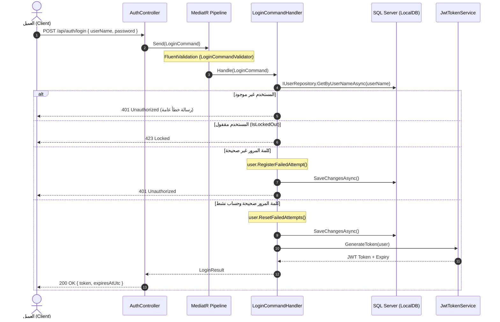
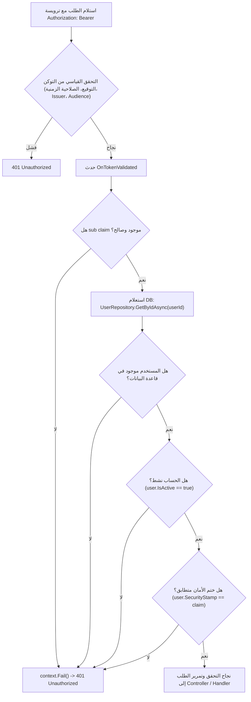

# Authentication & Authorization Flow — Maintenance Request Management System

توثيق مسار المصادقة والتحقق من الـ Tokens وإدارة الـ SecurityStamp.

---

## 1. نظرة عامة

يعتمد النظام على نظام مصادقة مخصص (Custom JWT Authentication) مبني بالكامل دون استخدام ASP.NET Core Identity (وفقاً للقرار المعماري `ADR-0001`).

---

## 2. تدفق تسجيل الدخول (Login Flow)

### Claims المضمنة في JWT Token:

| Claim | المصدر | الغرض |
|---|---|---|
| `sub` | `User.Id` | المعرف الفريد للمستخدم (Guid v7) |
| `nameid` | `User.Id` | التوافق مع Claims القياسية |
| `unique_name` | `User.UserName` | اسم المستخدم |
| `email` | `User.Email` | البريد الإلكتروني |
| `role` | `Role.Name` | الدور الممنوح (مثل `MaintenanceAdmin`, `Employee`) |
| `security_stamp` | `User.SecurityStamp` | ختم الأمان لإبطال التوكنات |
| `iat` | `DateTimeOffset.UtcNow` | وقت الإصدار |
| `exp` | `UtcNow + 60 minutes` | وقت انتهاء الصلاحية |
| `iss` | `JwtOptions.Issuer` | مصدر التوكن |
| `aud` | `JwtOptions.Audience` | الجمهور المستهدف |

---

## 3. تدفق التحقق في كل طلب (Request Validation Flow & OnTokenValidated)

عند إرسال أي طلب إلى مسار محمي بـ `[Authorize]`:

### ترتيب التحقق الدقيق داخل `OnTokenValidated`:
1. **التحقق من `sub` claim:** التأكد من وجوده وصلاحيته كـ `Guid`.
2. **استعلام المستخدم:** جلب المستخدم من قاعدة البيانات بواسطة `IUserRepository.GetByIdAsync(userId)`.
3. **التحقق من نشاط الحساب (`IsActive`):** إذا كان `false`، يُرفض الطلب فوراً.
4. **التحقق من تطابق `SecurityStamp`:** مقارنة القيمة المخزنة في DB مع القيمة الموجودة داخل Claim التوكن. إذا اختلفت، يُستدعى `context.Fail()` ويُرفض الطلب بـ `401 Unauthorized`.

---

## 4. أحداث تجديد `SecurityStamp` وإبطال التوكنات (Token Invalidation)

يتم تجديد `SecurityStamp` عبر استدعاء `User.RegenerateSecurityStamp()` في الحالات التالية:
1. **تغيير كلمة المرور:** سواء تم التغيير ذاتياً أو إعادة تعيينها بواسطة المسؤول (`Admin Password Reset`).
2. **تعديل أدوار المستخدم:** عند إضافة أو حذف دور من أدوار المستخدم، لضمان عدم استمرار التوكن القديم بصلاحيات منتهية.
3. **تعطيل حساب المستخدم:** عند إلغاء تفعيل المستخدم (`user.Deactivate()`).

> [!NOTE]
> بمجرد تجديد `SecurityStamp` في قاعدة البيانات، تصبح جميع التوكنات الصادرة سابقاً لهذا المستخدم غير صالحة تلقائياً في الطلب التالي، دون الحاجة لانتظار انتهاء صلاحيتها الزمنية (60 دقيقة).

---

## 5. المفاضلة المعمارية وتأثير الأداء (Performance Trade-off)

> [!IMPORTANT]
> **ملاحظة أداء حرجة (Database Roundtrip on Each Request):**
> التحقق من `SecurityStamp` و `IsActive` داخل حدث `OnTokenValidated` يتطلب استعلام قاعدة بيانات إضافي (`SELECT FROM Users`) مع كل طلب وارد إلى الـ API المصادق عليه.
> 
> **المبرر:**
> - يوفر إبطالاً فورياً وآمناً للتوكنات (Instant Revocation) دون الحاجة لتعقيد إضافي مثل إدارة Blacklist مركزية في Redis أو Message Broker في هذه المرحلة الأولية من المشروع.
> - يضمن تطبيق تغيير الصلاحيات وإغلاق الحسابات فوراً دون ثغرات أمنية.
> - استعلام المستخدم يتم عبر المفتاح الأساسي المعنقد (`Id` بنوع Guid v7)، وهو استعلام سريع جداً ومفهرس بالكامل.

