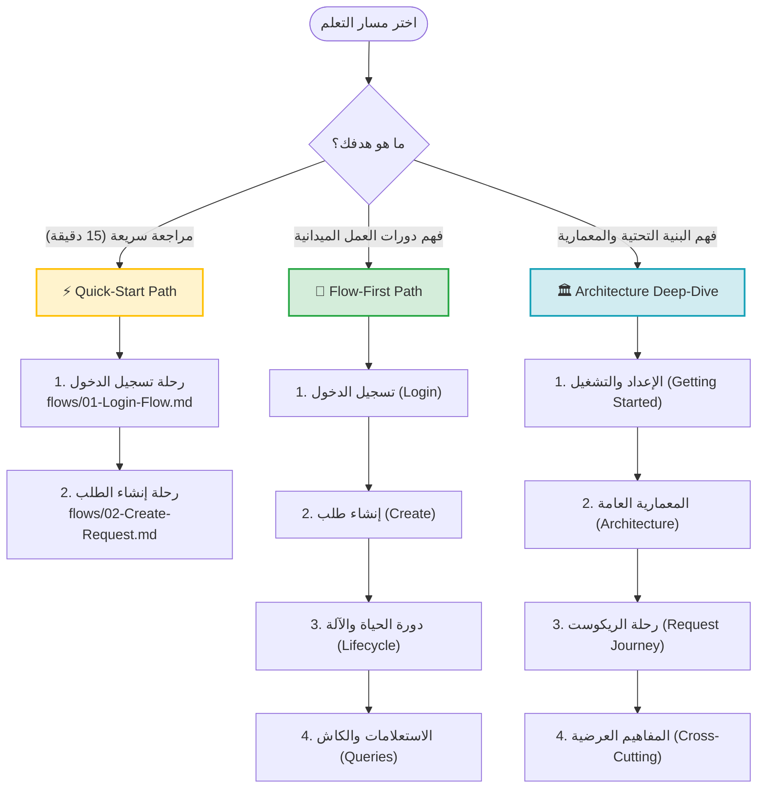

# 📚 الدليل التعليمي لنظام إدارة طلبات الصيانة (Learning Hub)

> البوابة الرئيسية ودليل التنقل الشامل للوثائق التعليمية والمعمارية لمشروع **Maintenance Request Management System**. صُممت هذه السلسلة لتشرح بالتفصيل كيف يعمل النظام المكتوب بإطار **.NET 10** وفق **معمارية البصلة (Onion Architecture)** ونمط **CQRS** و**نموذج الدومين الغني (Rich Domain Model)**.

---

## 🌟 1. مقدمة وفلسفة النظام (Welcome & Philosophy)

بُني هذا النظام ليكون مثالاً واقعياً وعملياً على بناء وتطوير الأنظمة المؤسسية (Enterprise-grade APIs) دون الاعتماد على حلول مسبقة مقيدة:
- **نظام مصادقة مخصص (Custom Auth):** تجنب كامل لـ `ASP.NET Core Identity` وجداولها المفروضة وفق [ADR-0001](file:///C:/Users/KC-PC/source/repos/MaintenanceSystem/docs/adr/0001-custom-auth.md).
- **أحدث تقنيات مايكروسوفت:** اعتماد **.NET 10** و C# 14 مع معرفات **UUIDv7** الزمنية المدمجة عبر `Guid.CreateVersion7()`.
- **دومين غني ومحمي:** كينونات الدومين هي حارسة قواعد الأعمال وآلة الحالة (State Machine)؛ لا يوجد كود سلوكي داخل الـ Controllers أو Handlers.
- **انعدام الثقة بالعميل (Zero-Trust Identity):** استخراج الهويات والأدوار حصراً من التوكنات الموقعة رقمياً عبر `ICurrentUserService`.

---

## 🗺️ 2. مسارات التعلم المقترحة (Recommended Learning Paths)

اختر المسار الأنسب لهدفك ووقتك المتاح:

### ⚡ أ) المسار السريع للمراجعة (Quick-Start Path)
*مناسب للمطور الذي يريد أخذ فكرة سريعة ودقيقة عن أسلوب كتابة الكود خلال 15 دقيقة:*
1. [`flows/01-Login-Flow.md`](file:///C:/Users/KC-PC/source/repos/MaintenanceSystem/docs/learning/flows/01-Login-Flow.md): استكشاف المصادقة، تشفير BCrypt، قفل الحساب، وإصدار JWT.
2. [`flows/02-Create-Request.md`](file:///C:/Users/KC-PC/source/repos/MaintenanceSystem/docs/learning/flows/02-Create-Request.md): استكشاف استقبال الطلب، التحقق التلقائي، وهوية الدومين والحالة الابتدائية.

---

### 🔄 ب) مسار دورات العمل والعمليات (Flow-First Path)
*مناسب لمطوري التطبيقات والواجهات لفهم رحلة البيانات من الطلب وحتى الاستجابة:*
1. [`flows/01-Login-Flow.md`](file:///C:/Users/KC-PC/source/repos/MaintenanceSystem/docs/learning/flows/01-Login-Flow.md): تسجيل الدخول وتوليد التوكن.
2. [`flows/02-Create-Request.md`](file:///C:/Users/KC-PC/source/repos/MaintenanceSystem/docs/learning/flows/02-Create-Request.md): تقديم طلب صيانة وتعيين الحالة الابتدائية.
3. [`flows/03-Lifecycle-Operations.md`](file:///C:/Users/KC-PC/source/repos/MaintenanceSystem/docs/learning/flows/03-Lifecycle-Operations.md): آلة الحالة (`Assign`, `Status`, `Reject`) وفحص ملكية المورد.
4. [`flows/04-Query-Operations.md`](file:///C:/Users/KC-PC/source/repos/MaintenanceSystem/docs/learning/flows/04-Query-Operations.md): استعلامات الترقيم والفلترة والتخزين المؤقت مع Redis.

---

### 🏛️ ج) مسار الغوص المعماري العميق (Architecture Deep-Dive)
*مناسب لمهندسي النظم ومطوري الباك إند لبناء وتوسيع النظام:*
1. [`01-Getting-Started.md`](file:///C:/Users/KC-PC/source/repos/MaintenanceSystem/docs/learning/01-Getting-Started.md): تهيئة البيئة، الأسرار، وقاعدة البيانات.
2. [`03-Architecture-Overview.md`](file:///C:/Users/KC-PC/source/repos/MaintenanceSystem/docs/learning/03-Architecture-Overview.md): تشريح طبقات البصلة الأربع وتكامل MediatR.
3. [`02-Request-Journey.md`](file:///C:/Users/KC-PC/source/repos/MaintenanceSystem/docs/learning/02-Request-Journey.md): خط أنابيب ASP.NET Core الوسيط وتوجيه الطلبات.
4. المفاهيم العرضية الشاملة:
   - [`cross-cutting/01-Exception-Handling.md`](file:///C:/Users/KC-PC/source/repos/MaintenanceSystem/docs/learning/cross-cutting/01-Exception-Handling.md): معالجة الأخطاء بصيغة RFC 7807.
   - [`cross-cutting/02-Security-Layers.md`](file:///C:/Users/KC-PC/source/repos/MaintenanceSystem/docs/learning/cross-cutting/02-Security-Layers.md): طبقات الأمان والسياسات وعزل الصلاحيات.
   - [`cross-cutting/03-Testing-Strategy.md`](file:///C:/Users/KC-PC/source/repos/MaintenanceSystem/docs/learning/cross-cutting/03-Testing-Strategy.md): هرم الاختبارات الشامل (Unit & Integration).

---

## 📑 3. الفهرس الشامل لكافة الملفات (Master File Index)

| # | اسم الملف ورابطه | النوع | الحالة | الوصف الموجز |
|---|---|---|:---:|---|
| **00** | [`00-README.md`](file:///C:/Users/KC-PC/source/repos/MaintenanceSystem/docs/learning/00-README.md) | Index | ✅ | الفهرس الرئيسي وخريطة التنقل ومسارات التعلم. |
| **01** | [`01-Getting-Started.md`](file:///C:/Users/KC-PC/source/repos/MaintenanceSystem/docs/learning/01-Getting-Started.md) | Setup | ✅ | دليل الإعداد والتشغيل المحلي وضبط User Secrets وقواعد البيانات. |
| **02** | [`02-Request-Journey.md`](file:///C:/Users/KC-PC/source/repos/MaintenanceSystem/docs/learning/02-Request-Journey.md) | Conceptual | ✅ | تفصيل رحلة الريكوست عبر خط الأنابيب (Pipeline) والوسائط في ASP.NET Core. |
| **03** | [`03-Architecture-Overview.md`](file:///C:/Users/KC-PC/source/repos/MaintenanceSystem/docs/learning/03-Architecture-Overview.md) | Conceptual | ✅ | المعمارية البصلية، الشرائح العمودية (Vertical Slices)، والـ Rich Domain. |
| **F1** | [`flows/01-Login-Flow.md`](file:///C:/Users/KC-PC/source/repos/MaintenanceSystem/docs/learning/flows/01-Login-Flow.md) | Flow | ✅ | دورة حياة تسجيل الدخول، هاش BCrypt، قفل الحساب، وتوليد JWT. |
| **F2** | [`flows/02-Create-Request.md`](file:///C:/Users/KC-PC/source/repos/MaintenanceSystem/docs/learning/flows/02-Create-Request.md) | Flow | ✅ | إنشاء طلب صيانة، التحقق التلقائي، وهوية الدومين الموثوقة. |
| **F3** | [`flows/03-Lifecycle-Operations.md`](file:///C:/Users/KC-PC/source/repos/MaintenanceSystem/docs/learning/flows/03-Lifecycle-Operations.md) | Flow | ✅ | آلة الحالة لطلب الصيانة، الإسناد، التحديث، الرفض، وملكية المورد. |
| **F4** | [`flows/04-Query-Operations.md`](file:///C:/Users/KC-PC/source/repos/MaintenanceSystem/docs/learning/flows/04-Query-Operations.md) | Flow | ✅ | استعلامات الترقيم والفلترة، AsNoTracking، وتخزين Redis المؤقت. |
| **C1** | [`cross-cutting/01-Exception-Handling.md`](file:///C:/Users/KC-PC/source/repos/MaintenanceSystem/docs/learning/cross-cutting/01-Exception-Handling.md) | Cross-Cutting | ✅ | شجرة الاستثناءات، ترجمة الرموز، وصيغة RFC 7807 ProblemDetails. |
| **C2** | [`cross-cutting/02-Security-Layers.md`](file:///C:/Users/KC-PC/source/repos/MaintenanceSystem/docs/learning/cross-cutting/02-Security-Layers.md) | Cross-Cutting | ✅ | طبقات الدفاع السبع: التشفير، التوكنات، طابع الأمان، القفل، السياسات، ملكية الموارد، ومنع الحصر. |
| **C3** | [`cross-cutting/03-Testing-Strategy.md`](file:///C:/Users/KC-PC/source/repos/MaintenanceSystem/docs/learning/cross-cutting/03-Testing-Strategy.md) | Cross-Cutting | ✅ | استراتيجية وهرم الاختبارات (Domain, Application, Integration Tests). |

---

## ⚙️ 4. المتطلبات والبيئة التقنية (Prerequisites & Tech Stack)

لفهم وتشغيل الكود البرمجي المشروح في هذه السلسلة، يجب توفر التالي:

- **بيئة التطوير:**
  - [.NET 10 SDK](https://dotnet.microsoft.com/) مع C# 14.
  - Visual Studio 2026 أو VS Code أو JetBrains Rider.
- **قواعد البيانات والتخزين:**
  - SQL Server LocalDB: `(localdb)\MSSQLLocalDB` (اسم القاعدة: `MaintenanceSystemDb`).
  - Redis Server: `127.0.0.1:6379` (يمكن استخدام Memurai Developer Edition على Windows).
- **المكتبات الأساسية المستخدمة:**
  - **MediatR:** لتطبيق نمط الوسيط (Mediator) وفصل الـ Commands عن الـ Queries.
  - **FluentValidation:** لفحص المدخلات التلقائي عبر Pipeline Behaviors.
  - **Entity Framework Core 10:** للتعامل مع قاعدة البيانات وتطبيق الميجريشنز.
  - **StackExchange.Redis:** لتنفيذ التخزين المؤقت الموزع.
  - **BCrypt.Net-Next:** لتشفير وتجزئة كلمات المرور بأمان عالٍ.

---

## 🔗 5. الوثائق المعمارية المرجعية (Related Architecture Docs)

هذه الوثائق التعليمية مبنية على أسس ومواثيق هندسية موثقة في مجلد `docs/`:

- [`architecture-guide.md`](file:///C:/Users/KC-PC/source/repos/MaintenanceSystem/docs/architecture-guide.md): الدليل المعماري الشامل للنظام وقواعد الطبقات.
- [`database-design.md`](file:///C:/Users/KC-PC/source/repos/MaintenanceSystem/docs/database-design.md): مخطط قاعدة البيانات، الجداول، العلاقات، والفهارس.
- [`adr/0001-custom-auth.md`](file:///C:/Users/KC-PC/source/repos/MaintenanceSystem/docs/adr/0001-custom-auth.md): قرار اعتماد Custom Auth وتجنب ASP.NET Identity.
- [`development-plan.md`](file:///C:/Users/KC-PC/source/repos/MaintenanceSystem/docs/development-plan.md): خطة التطوير من MS-001 إلى MS-050.
- [`TASKS.md`](file:///C:/Users/KC-PC/source/repos/MaintenanceSystem/docs/learning/TASKS.md): جدول تقدم ومواصفات مهام الوثائق التعليمية.
- [`TEMPLATE.md`](file:///C:/Users/KC-PC/source/repos/MaintenanceSystem/docs/learning/TEMPLATE.md): القالب المعياري المعتمد لكتابة هذه الوثائق.

---

## 💡 6. نصائح للمطورين (Golden Reading Tips)

> [!TIP]
> - **اقرأ المخططات أولاً:** ابدأ كل وثيقة باستعراض مخطط الـ Mermaid التتابعي (Sequence Diagram)؛ فهو يلخص مسار البيانات بين الطبقات في نظرة واحدة.
> - **افتح الأكواد عبر الروابط:** كافة أسماء الملفات البرمجية مزودة بروابط محلية `file://` مباشرة تفتح الكود في محررك فور النقر عليها.
> - **طبق أمثلة cURL و PowerShell:** تحتوي وثائق الـ Flows على استدعاءات جاهزة لتجربة مسارات النجاح والفشل محلياً وفهم الاستجابات والاستثناءات بشكل عملي.
