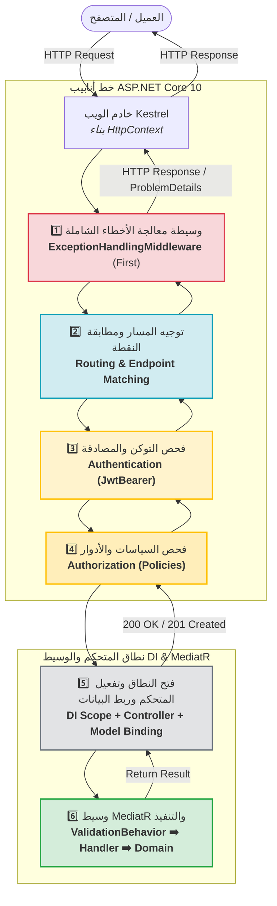
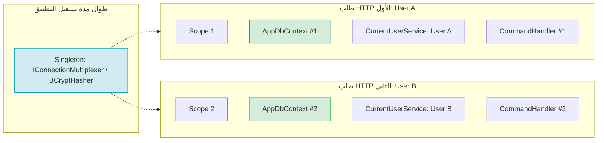

# 🌐 رحلة الريكوست في ASP.NET Core 10 (Request Journey)

> وثيقة مفاهيمية معمارية تشرح المسار الهندسي الكامل لطلب HTTP داخل نظام إدارة طلبات الصيانة عبر خط الأنابيب (Pipeline)، بدءاً من استقبال الاتصال عبر خادم Kestrel، مروراً بطبقات الحماية والمصادقة، وحتى بلوغ كود الدومين والعودة بالاستجابة.

---

## 🗺️ 1. المخطط الهندسي الشامل لرحلة الطلب (The Request Lifecycle)

يمر كل طلب وارد عبر نموذج **الدمية الروسية (Russian Doll Model)**، حيث تلتف الوسائط (Middlewares) حول بعضها البعض بالتسلسل الدقيق التالي:

---

## 🚉 2. تفصيل المحطات الست في كود النظام (The 6 Stations)

كما هو موثق في ملف الإقلاع الرئيسي [`Program.cs`](file:///C:/Users/KC-PC/source/repos/MaintenanceSystem/src/MaintenanceSystem.API/Program.cs)، يتم ترتيب المحطات بأعلى دقة:

### 1️⃣ المحطة الأولى: وسيطة الأخطاء الشاملة (ExceptionHandlingMiddleware - First)
- **الموقع في الكود:** أول وسيطة بعد بناء التطبيق `app.UseMiddleware<ExceptionHandlingMiddleware>()`.
- **الوظيفة:**
  - تغلف كامل مسار الريكوست داخل كتلة `try/catch`.
  - تلتقط أي استثناء غير معالج يقع في أي مرحلة لاحقة (في الـ Controllers، أو Handlers، أو Domain Entities).
  - تقوم بترجمة الاستثناء البرمجي إلى كائن معتمد لمواصفة **RFC 7807 (`ProblemDetails`)** وتمنع خروج تفاصيل الاستثناءات الحساسة (Stack Traces) للعميل في بيئات الإنتاج.

> [!IMPORTANT]
> **لماذا توضع وسيطة الأخطاء أولاً دائماً؟**
> لأنها تمثل الطبقة الخارجية؛ إذا وُضعت بعد الـ Routing أو Auth فلن تتمكن من التقاط الأخطاء التي تحدث داخل تلك المكونات، مما قد يؤدي لانهيار الطلب بدون استجابة JSON منسقة.

---

### 2️⃣ المحطة الثانية: توجيه المسار ومطابقة نقطة النهاية (Routing & Endpoint Matching)
- **الموقع في الكود:** تفعيل التوجيه عبر `app.MapControllers()` وتحديد المسارات بالسمات `[Route("api/...")]`.
- **الوظيفة:**
  - يحلل محرك التوجيه (Endpoint Routing Engine) نوع بروتوكول الطلب (`GET`, `POST`, `PATCH`...) ونصه (URI).
  - يطابق الطلب مع المعرف البرمجي للـ Action المناسب في الـ Controller.
  - يستخرج متغيرات المسار الديناميكية (Route Parameters) مثل `{id:guid}` ويتحقق من صحة نوعها قبل المتابعة.

---

### 3️⃣ المحطة الثالثة: التحقق من التوكن والهوية (Authentication Flow)
- **الموقع في الكود:** `app.UseAuthentication()` وتوسعة [`AuthenticationExtensions.cs`](file:///C:/Users/KC-PC/source/repos/MaintenanceSystem/src/MaintenanceSystem.API/Extensions/AuthenticationExtensions.cs).
- **الوظيفة:**
  1. استخراج الـ Bearer Token من ترويسة `Authorization: Bearer <token>`.
  2. التحقق من التوقيع الرقمي بمفتاح `Jwt:SigningKey` وفحص جهة الإصدار (`Issuer`)، والجمهور (`Audience`)، وتاريخ انتهاء الصلاحية دون أي تساهل زمني (`ClockSkew = TimeSpan.Zero`).
  3. **الحدث المخصص الحرج (`OnTokenValidated`):**
     - استخراج معرف المستخدم `sub` والتحقق من وجوده في قاعدة البيانات عبر [`IUserRepository`](file:///C:/Users/KC-PC/source/repos/MaintenanceSystem/src/MaintenanceSystem.Application/Abstractions/Persistence/IUserRepository.cs).
     - التأكد من أن الحساب نشط (`user.IsActive == true`).
     - **مطابقة طابع الأمان (`SecurityStamp`):** التأكد من تطابق الـ Claim مع القيمة المخزنة في قاعدة البيانات لإبطال التوكن فورياً إذا تغيرت كلمة المرور أو أُغلق الحساب.
  4. بناء كائن الهوية `HttpContext.User` وجعله متاحاً للمحطات اللاحقة.

---

### 4️⃣ المحطة الرابعة: فحص الصلاحيات والسياسات (Authorization Flow)
- **الموقع في الكود:** `app.UseAuthorization()` وسياسات [`AuthorizationExtensions.cs`](file:///C:/Users/KC-PC/source/repos/MaintenanceSystem/src/MaintenanceSystem.API/Authorization/AuthorizationExtensions.cs).
- **الوظيفة:**
  - فحص متطلبات نقطة النهاية المحددة بالسمات:
    - `[AllowAnonymous]`: السماح بالمرور دون أي قيود (مثل تسجيل الدخول).
    - `[Authorize]`: اشتراط وجود مستخدم موثق وصالح.
    - `[Authorize(Policy = Policies.MaintenanceAdminOnly)]`: اشتراط امتلاك المستخدم لدور مدير صيانة.
    - `[Authorize(Policy = Policies.TechnicianOrAdmin)]`: السماح للفنيين أو المدراء فقط.
  - في حال الفشل: يقطع خط الأنابيب فورياً ويرجع `401 Unauthorized` (إذا كان مجهولاً) أو `403 Forbidden` (إذا كان يفتقر للدور المطلوب).

---

### 5️⃣ المحطة الخامسة: فتح النطاق وتفعيل المتحكم وربط البيانات (DI Scope & Model Binding)
- **الوظيفة الهندسية:**
  1. **إنشاء نطاق الحقن (`IServiceScope`):** يفتح إطار العمل نطاقاً مستقلاً (Scoped) خاصاً بهذا الريكوست الفردي.
  2. **تفعيل المتحكم (Controller Activation):** يتم إنشاء نسخة جديدة من الـ Controller وحقن التبعيات المطلوبة في منشئه (مثل `ISender` الخاص بـ MediatR).
  3. **ربط البيانات (Model Binding):**
     - قراءة وتفكيك محتوى JSON من الـ Body وتحويله لكائن الطلب (Request DTO).
     - قراءة معاملات الرابط (Query Parameters) مثل `page` و `pageSize` وتحويل أنواعها بدقة.
     - في حال وجود أخطاء في صياغة الـ JSON (Malformed JSON)، يرفض الإطار الطلب بـ `400 Bad Request`.

---

### 6️⃣ المحطة السادسة: وسيط MediatR والتنفيذ الفعلي (MediatR Pipeline & Business Handler)
- **الملفات المعنية:**
  - خط أنابيب التحقق: [`ValidationBehavior.cs`](file:///C:/Users/KC-PC/source/repos/MaintenanceSystem/src/MaintenanceSystem.Application/Common/Behaviors/ValidationBehavior.cs)
  - المعالج الميداني (Command/Query Handler).
  - كينونات الدومين وقاعدة البيانات.
- **ماذا يحدث داخل هذه المحطة؟**
  1. يستلم MediatR الأمر أو الاستعلام عبر `_sender.Send(...)`.
  2. يعترض وسيط `ValidationBehavior` الريكوست ويمرر الكائن إلى فئات `FluentValidation` (فحص الأطوال، منع `Guid.Empty`، إلخ). إذا وُجد خطأ يُرمى `ValidationException` ليعود للمحطة الأولى.
  3. يصل الطلب إلى الـ Handler المخصص.
  4. يستدعي الـ Handler كينونات الدومين الغنية لتنفيذ المنطق السلوكي وتعديل الحالة.
  5. تُحفظ التغييرات في قاعدة البيانات، ثم تُبنى الاستجابة وتعود عكسياً عبر المحطات حتى تصل للعميل كاستجابة `200 OK` أو `201 Created`.

---

## ⏳ 3. دورة حياة الكائنات ونطاقات حقن التبعيات (Dependency Injection Lifetimes)

يوظف النظام حاوية الحقن المدمجة في .NET 10 عبر ثلاثة أنماط حياة محددة بدقة:

| نمط دورة الحياة (Lifetime) | متى يُنشأ الكائن؟ | متى يُحذف من الذاكرة؟ | أمثلة حية من مشروعنا |
| :--- | :--- | :--- | :--- |
| **`Singleton`** | مرة واحدة فقط عند بدء تشغيل التطبيق. | عند إيقاف الخادم بالكامل. | - `IConnectionMultiplexer` (اتصال Redis الموزع). - `IPasswordHasher` (مشفر BCrypt). - `IMaintenanceTypeCache`. |
| **`Scoped`** | نسخة جديدة خاصة بكل طلب HTTP مستقل. | فور انتهاء طلب الـ HTTP وخروج الاستجابة. | - `AppDbContext` (سياق EF Core ومتابعة التغييرات). - `ICurrentUserService` (المعتمد على HttpContext). - كافة الـ Repositories والـ Handlers. |
| **`Transient`** | نسخة جديدة في كل مرة يُطلب فيها الكائن عبر المنشئ. | بمجرد انتهاء استدعاء الدالة واستلامها من Garbage Collector. | - فئات التحقق `IValidator<T>` في FluentValidation. - محولات خفيفة أو خدمات عابرة. |

> [!WARNING]
> **خطر كبس النطاقات (Captive Dependency Anti-Pattern):**
> لا تقم أبداً بحقن خدمة من نوع `Scoped` (مثل `AppDbContext` أو `ICurrentUserService`) داخل خدمة من نوع `Singleton` (مثل `IPasswordHasher` أو كائن كاش دائم)؛ لأن هذا سيجعل الخدمة الـ Scoped محبوسة طوال عمر التطبيق، مما يؤدي لمشاكل تلوث البيانات (Memory Leaks / Cross-Tenant Data Leakage) وتعطل الاتصال المتزامن لقاعدة البيانات.

---

## 💡 4. نقاط ذهبية للمعماريين (Golden Architecture Takeaways)

> [!TIP]
> - **تذكر الترتيب الصارم:** وسيطة الأخطاء `ExceptionHandlingMiddleware` أولاً، ثم `UseRouting`، ثم `UseAuthentication`، ثم `UseAuthorization`؛ أي خلط في هذا الترتيب يكسر أمان النظام تماماً.
> - **تذكر أن المصادقة (AuthN) تسبق التخويل (AuthZ):** يجب أن يتعرف النظام على هوية صاحب الطلب أولاً (`Who are you?`) قبل أن يقرر ما إذا كان مسموحاً له بالوصول (`What are you allowed to do?`).
> - **تذكر أن الـ Controller لا يعالج البيانات:** دور الـ Controller في معماريتنا هو محول بروتوكول فقط (Protocol Adapter) يترجم طلب الـ HTTP إلى Command/Query ليمر عبر MediatR.
> - **مشكلة شائعة جداً:** إتاحة `ICurrentUserService` عبر قراءة الترويسات مباشرة في Handler؛ الحل الأصح والمعتمد هو استخدام `IHttpContextAccessor` داخل طبقة الـ Infrastructure فقط لتظل طبقة الـ Application نقية ومستقلة عن مكتبات الـ Web.
