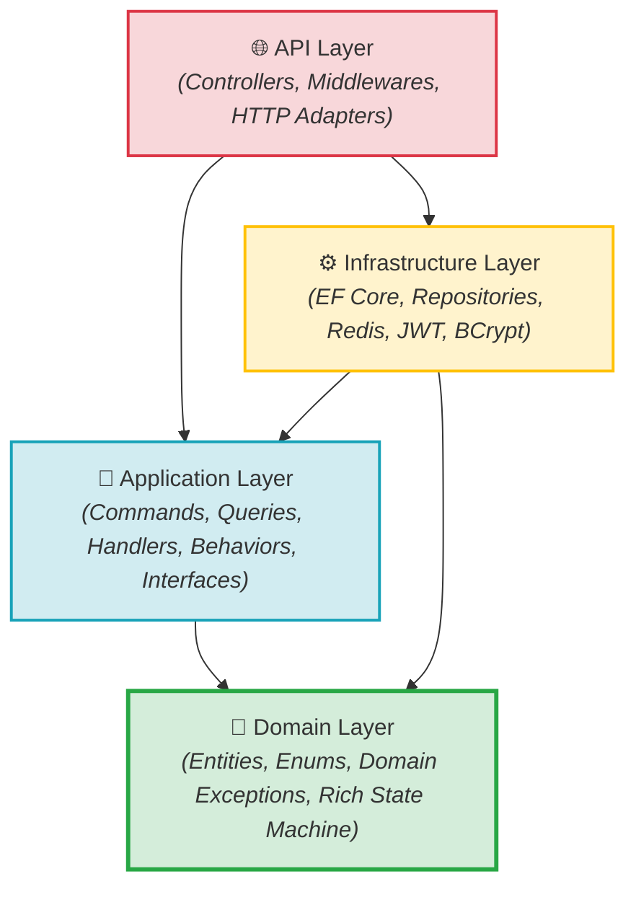
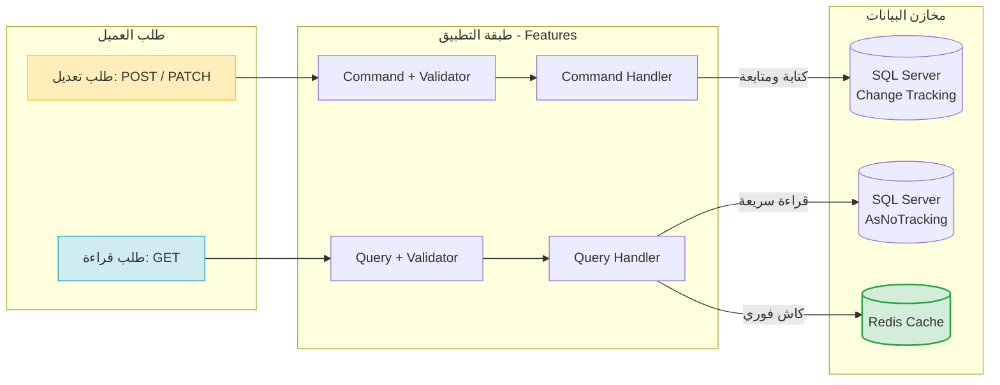
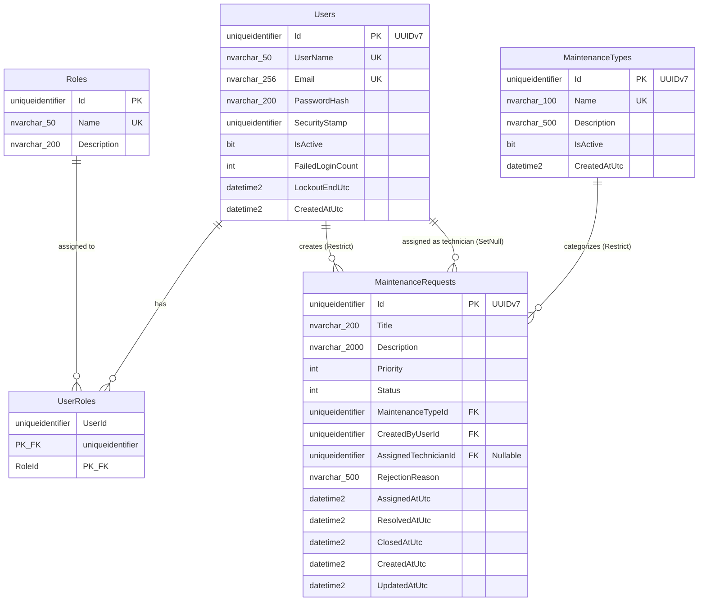

# 🏛️ النظرة المعمارية العامة (Architecture Overview)

> وثيقة مفاهيمية تشرح المعمارية العامة لنظام إدارة طلبات الصيانة، متضمنةً معمارية البصلة (Onion Architecture)، نمط فصل المسؤوليات (CQRS)، نموذج الدومين الغني (Rich Domain Model)، الشرائح العمودية (Vertical Slices)، ومخطط قاعدة البيانات مع هجرات EF Core التطورية.

---

## 🧅 1. معمارية البصلة وقاعدة التبعيات الذهبية (Onion Architecture)

يعتمد النظام **معمارية البصلة (Onion Architecture)** مقسمة إلى أربعة مشاريع رئيسية، تحكمها **قاعدة الاعتماديات الذهبية**:

> [!IMPORTANT]
> **قاعدة الاعتماديات الذهبية (The Golden Dependency Rule):**
> **الاعتماديات تتجه دائماً من الخارج إلى الداخل. الطبقات الداخلية لا تعرف شيئاً على الإطلاق عن الطبقات الخارجية.**

---

## 🔍 2. تشريح الطبقات الأربع (The 4 Layers in Detail)

### 💎 1. طبقة الدومين (Domain Layer) — النواة النقية
- **المشروع:** [`MaintenanceSystem.Domain`](file:///C:/Users/KC-PC/source/repos/MaintenanceSystem/src/MaintenanceSystem.Domain)
- **المسؤولية:** حماية قواعد العمل الجوهرية للكيانات ومفاهيم النظام.
- **الخصائص المعمارية:**
  - **صفر اعتماديات خارجية:** لا تعتمد على أي مكتبة خارجية أو إطار عمل (لا EF Core ولا ASP.NET Core).
  - **نموذج دومين غني (Rich Domain Model):** الكيانات ليست مجرد حاويات بيانات خاملة (Anemic)، بل تحوي دوالاً سلوكية تحمي حالتها الذاتية وتدير آلة الحالة (مثل `Start()`, `Resolve()`, `Close()`, `Reject()`).
  - **المعرفات:** تعتمد معرفات الإصدار السابع الزمنية المدمجة في .NET 10 عبر `Guid.CreateVersion7()`.
  - **المحتويات:** الكينونات (`User`, `Role`, `MaintenanceType`, `MaintenanceRequest`)، التعدادات (`MaintenancePriority`, `MaintenanceRequestStatus`)، واستثناءات الدومين (`InvalidStateTransitionException`, `BusinessRuleViolationException`).

---

### 💼 2. طبقة التطبيق (Application Layer) — منسق العمليات
- **المشروع:** [`MaintenanceSystem.Application`](file:///C:/Users/KC-PC/source/repos/MaintenanceSystem/src/MaintenanceSystem.Application)
- **المسؤولية:** تنسيق حالات الاستخدام (Use Cases) وتوجيه تدفق البيانات بين الواجهة وقواعد العمل.
- **الخصائص المعمارية:**
  - تعرف فقط طبقة `Domain`.
  - **نمط الوسيط (CQRS via MediatR):** تقسيم كل حالة استخدام إلى أمر (`Command`) أو استعلام (`Query`) مع معالج مخصص (`Handler`).
  - **التحقق المركزي (Cross-Cutting Pipeline):** فحص البيانات التلقائي عبر `ValidationBehavior` باستخدام `FluentValidation` دون تلوث المعالجات.
  - **الواجهات المجردة (Abstractions):** تعريف عقود التعامل مع البنية التحتية (`IMaintenanceRequestRepository`, `IUserRepository`, `IMaintenanceTypeCache`, `ICurrentUserService`).

---

### ⚙️ 3. طبقة البنية التحتية (Infrastructure Layer) — التفاصيل التقنية
- **المشروع:** [`MaintenanceSystem.Infrastructure`](file:///C:/Users/KC-PC/source/repos/MaintenanceSystem/src/MaintenanceSystem.Infrastructure)
- **المسؤولية:** تقديم التنفيذ العملي لكافة الواجهات المحددة في طبقة التطبيق.
- **الخصائص المعمارية:**
  - تعرف `Application` و `Domain`.
  - **الوصول للبيانات (EF Core 10):** فئات `AppDbContext` والـ Configurations والـ Repositories المخصصة لكل كيان (دون استخدام Generic Repository).
  - **الأمان والتشفير:** تنفيذ تشفير كلمات المرور عبر `BCryptPasswordHasher`، وتوليد التوكنات عبر `JwtTokenService`.
  - **التخزين المؤقت:** تنفيذ كاش Redis الموزع عبر `RedisMaintenanceTypeCache` ونمط Cache-Aside.

---

### 🌐 4. طبقة الواجهة البرمجية (API Layer) — بوابة الوصول
- **المشروع:** [`MaintenanceSystem.API`](file:///C:/Users/KC-PC/source/repos/MaintenanceSystem/src/MaintenanceSystem.API)
- **المسؤولية:** استقبال اتصالات HTTP، الترجمة، وإرجاع الاستجابات المناسبة.
- **الخصائص المعمارية:**
  - **متحكمات نحيفة (Thin Controllers):** دور المتحكم لا يتعدى كونه محول بروتوكول (Protocol Adapter) يترجم الطلب إلى أمر/استعلام MediatR.
  - **معالجة الأخطاء الموحدة:** وسيطة `ExceptionHandlingMiddleware` لتحويل الاستثناءات إلى استجابات RFC 7807 (`ProblemDetails`).
  - **المصادقة والتفويض:** إعداد توكنات JWT وسياسات الأمان (`Policies.MaintenanceAdminOnly`, `Policies.TechnicianOrAdmin`).

---

## ⚡ 3. نمط CQRS والشرائح العمودية (CQRS & Vertical Slices)

يقسم النظام العمليات وفق نمط **فصل مسؤوليات الأوامر والاستعلامات (CQRS)** منظم داخل مجلدات ميزات عمودية (Vertical Slices):

- **مسار الكتابة (Commands):** يمر عبر كينونات الدومين، يطبق قواعد التحقق، ويحدث البيانات في SQL Server.
- **مسار القراءة (Queries):** يعتمد `.AsNoTracking()` لتوفير الذاكرة، ويتكامل مع Redis لتسريع الاستعلامات المتكررة دون الحاجة لفتح دورة تتبع في EF Core.

---

## 🗄️ 4. مخطط قاعدة البيانات وهجرات EF Core (Database Schema & Migrations)

### 📊 مخطط الكيانات والعلاقات (Entity-Relationship Diagram)

---

### 🔗 تفصيل العلاقات وسلوك الحذف (Foreign Key Constraints)

1. **`Users` ⬅️ `MaintenanceRequests.CreatedByUserId` (DeleteBehavior.Restrict):**
   - يمنع حذف أي مستخدم لديه طلبات صيانة مسجلة في النظام لحماية السجلات التاريخية.
2. **`MaintenanceTypes` ⬅️ `MaintenanceRequests.MaintenanceTypeId` (DeleteBehavior.Restrict):**
   - يمنع حذف أي نوع صيانة مرتبط بطلبات سابقة، ويُستعاض عن ذلك بخاصية التعطيل المنطقي `IsActive = false`.
3. **`Users` ⬅️ `MaintenanceRequests.AssignedTechnicianId` (DeleteBehavior.SetNull):**
   - في حال تعطيل أو حذف حساب الفني، يُضبط الحقل تلقائياً على `NULL` دون أن تتأثر بيانات طلب الصيانة نفسه.
4. **`UserRoles` (Composite PK):**
   - علاقة أطراف بأطراف (Many-to-Many) بين `Users` و `Roles` بقيود منع الحذف المادي `Restrict`.

---

### 📜 سجل الهجرات ومسار التطور (Migrations & `__EFMigrationsHistory`)

يدير Entity Framework Core تطور المخطط عبر الجدول الداخلي **`__EFMigrationsHistory`** الذي يسجل كل هجرة طُبقت في قاعدة البيانات لمنع تكرار التنفيذ.

تطور المخطط عبر ثلاث هجرات تراكمية متسلسلة:

| # | اسم الهجرة (Migration Name) | الغرض المعماري والكيانات المضافة |
|---|---|---|
| **1** | `20261014083212_InitialAuth` | تأسيس نظام المصادقة المخصص: جداول `Users`, `Roles`, `UserRoles` مع الفهارس الفريدة. |
| **2** | `20261014131550_AddMaintenanceTypes` | إضافة جدول `MaintenanceTypes` وتطبيق قيد فرادية الاسم وفهرس الحالة النشطة. |
| **3** | `20261014151047_AddMaintenanceRequests` | إضافة جدول `MaintenanceRequests` وربط المفاتيح الأجنبية (`Restrict` و `SetNull`). |

---

## 🚫 5. محظورات معمارية صارمة (Strict Architectural Constraints)

يلتزم المشروع بقواعد هندسية صارمة لا تقبل الاستثناء:

- ❌ **لا تستخدم ASP.NET Core Identity:** الاعتماد كلياً على Custom Auth وجداولنا الخاصة وفق [ADR-0001](file:///C:/Users/KC-PC/source/repos/MaintenanceSystem/docs/adr/0001-custom-auth.md).
- ❌ **لا تستخدم Generic Repository:** لكل كيان مستودع محدد يعبر عن حالات استخدامه الدقيقة (مثل `GetAssignedToTechnicianAsync`).
- ❌ **لا تستخدم AutoMapper:** استخدام منشئات DTO صريحة ومباشرة لضمان سهولة التتبع (Explicit Mapping).
- ❌ **لا تستخدم Unit of Work نمطي إضافي:** الاعتماد على `AppDbContext` المدمج كـ Unit of Work طبيعي لتجنب التجريد الزائد.
- ❌ **لا تستخدم Result Pattern مخصص:** الاستثناءات الصريحة تعالج في `ExceptionHandlingMiddleware` وترجع استجابات RFC 7807 القياسية.
- ❌ **لا كود سلوكي خارج الدومين:** يمنع منعاً باتاً تعديل حالة الكائن أو اتخاذ قرارات الانتقال داخل المتحكمات أو المعالجات.
