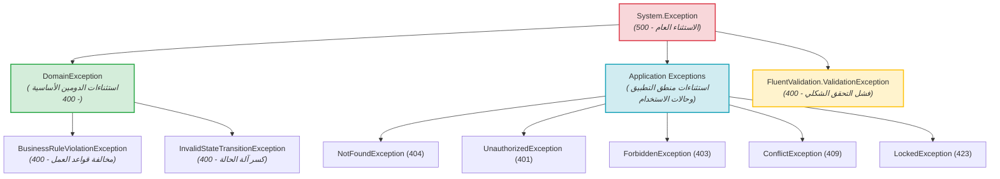
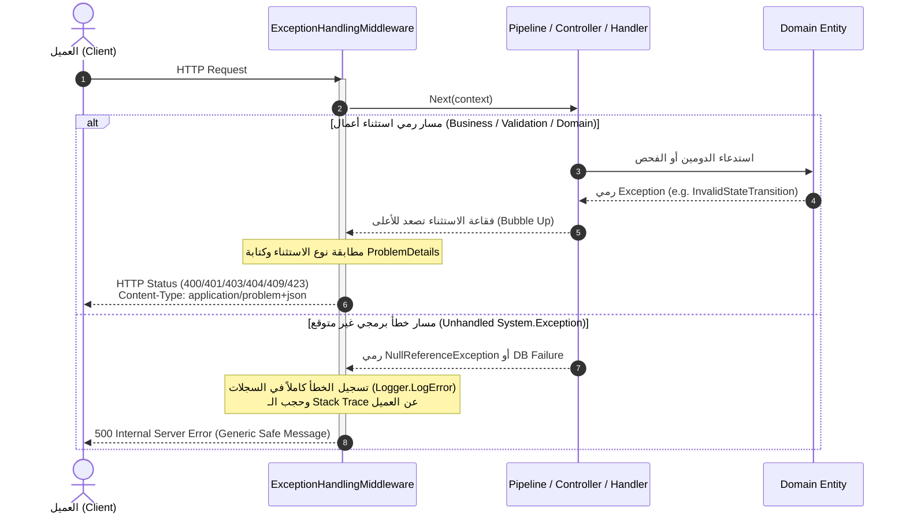

# ⚠️ المعالجة المركزية للاستثناءات (Centralized Exception Handling)

> وثيقة مفاهيمية تشرح الاستراتيجية المركزية المعتمدة في النظام لمعالجة الأخطاء والاستثناءات البرمجية، وتحويلها إلى استجابات HTTP قياسية وفق مواصفة **RFC 7807 (`ProblemDetails`)** عبر وسيطة مخصصة وبأعلى معايير الأمان لمنع تسريب البيانات الحساسة أو فحص الحسابات.

---

## 🌳 1. شجرة تصنيف الاستثناءات (Exception Taxonomy)

يقسم النظام الاستثناءات هندسياً بحسب الطبقة المسؤولة ومستوى خطأ الأعمال:



---

## 📊 2. جدول مطابقة رموز HTTP ومواصفات RFC (HTTP Mapping Table)

تترجم وسيطة [`ExceptionHandlingMiddleware.cs`](file:///C:/Users/KC-PC/source/repos/MaintenanceSystem/src/MaintenanceSystem.API/Middleware/ExceptionHandlingMiddleware.cs) كافة الاستثناءات وفق جدول المطابقة التالي:

| رمز الحالة (Status) | الاستثناء البرمجي (Exception) | مواصفة RFC المعيارية | سبب الحدوث الميداني |
| :--- | :--- | :--- | :--- |
| **`400 Bad Request`** | `ValidationException` | [RFC 7231 §6.5.1](https://tools.ietf.org/html/rfc7231#section-6.5.1) | فشل قواعد التحقق في الـ Pipeline (مثل حقل فارغ أو تجاوز الحد الأقصى للمحارف). يُرفق معه قاموس `validationErrors`. |
| **`400 Bad Request`** | `InvalidStateTransitionException` | [RFC 7231 §6.5.1](https://tools.ietf.org/html/rfc7231#section-6.5.1) | محاولة إجراء انتقال غير قانوني في دورة حياة الطلب (مثل بدء طلب New أو رفض طلب InProgress). |
| **`400 Bad Request`** | `BusinessRuleViolationException` | [RFC 7231 §6.5.1](https://tools.ietf.org/html/rfc7231#section-6.5.1) | انتهاك قاعدة داخل كينونة الدومين (مثل معرّف Guid فارغ أو سبب رفض تجاوز 500 حرف). |
| **`400 Bad Request`** | `DomainException` | [RFC 7231 §6.5.1](https://tools.ietf.org/html/rfc7231#section-6.5.1) | أي خطأ دومين عام لم يتم تخصيصه في صنف فرعي. |
| **`401 Unauthorized`** | `UnauthorizedException` | [RFC 7235 §3.1](https://tools.ietf.org/html/rfc7235#section-3.1) | فشل المصادقة (كلمة مرور خاطئة، حساب غير موجود، حساب معطل، أو غياب توكن Bearer). |
| **`403 Forbidden`** | `ForbiddenException` | [RFC 7231 §6.5.3](https://tools.ietf.org/html/rfc7231#section-6.5.3) | انتهاك ملكية المورد (Resource Ownership)، كأن يحاول فني تعديل طلب مسند لزميله أو موظف قراءة تفاصيل طلب موظف آخر. |
| **`404 Not Found`** | `NotFoundException` | [RFC 7231 §6.5.4](https://tools.ietf.org/html/rfc7231#section-6.5.4) | تعذر العثور على المورد المطلوب بالمعرّف الممرر في قاعدة البيانات. |
| **`409 Conflict`** | `ConflictException` | [RFC 7231 §6.5.8](https://tools.ietf.org/html/rfc7231#section-6.5.8) | تعارض في حالة بيانات العمل (مثل إسناد طلب لمستخدم لا يحمل دور فني، أو إنشاء طلب لنوع صيانة معطل). |
| **`423 Locked`** | `LockedException` | [RFC 4918 §11.2](https://tools.ietf.org/html/rfc4918#section-11.2) | الحساب مقفل زمنياً ومؤقتاً (15 دقيقة) لتجاوز 5 محاولات دخول فاشلة متتالية. |
| **`500 Internal Error`** | `Exception` (أي خطأ غير معالج) | [RFC 7231 §6.6.1](https://tools.ietf.org/html/rfc7231#section-6.6.1) | عطل برمجي غير متوقع أو انقطاع مفاجئ بالاتصال. **لا يُرسل أي Stack Trace للعميل**. |

---

## 🔄 3. مسار وسيطة الأخطاء الشاملة (Middleware Flow)

تعمل وسيطة [`ExceptionHandlingMiddleware.cs`](file:///C:/Users/KC-PC/source/repos/MaintenanceSystem/src/MaintenanceSystem.API/Middleware/ExceptionHandlingMiddleware.cs) كصمام أمان خارجي يحيط بكامل مسار الـ Pipeline:



---

## 📦 4. معيار RFC 7807 ProblemDetails وأمثلة حية

تُرسل كافة الاستجابات بترويسة المحتوى الرسمية:
```http
Content-Type: application/problem+json
```

### 1️⃣ مثال خطأ التحقق الشكلي (400 Bad Request مع `extensions.validationErrors`)
عند إرسال بيانات غير صالحة، تُجمع كافة الأخطاء الحقلية داخل كائن `validationErrors`:
```json
{
  "type": "https://tools.ietf.org/html/rfc7231#section-6.5.1",
  "title": "Validation Error",
  "status": 400,
  "detail": "One or more validation errors occurred.",
  "instance": "/api/maintenance-requests",
  "validationErrors": {
    "Title": [
      "العنوان مطلوب.",
      "العنوان لا يمكن أن يتجاوز 200 حرف."
    ],
    "MaintenanceTypeId": [
      "معرّف نوع الصيانة مطلوب."
    ]
  }
}
```

---

### 2️⃣ مثال كسر آلة الحالة (400 Bad Request — Invalid State Transition)
```json
{
  "type": "https://tools.ietf.org/html/rfc7231#section-6.5.1",
  "title": "Invalid State Transition",
  "status": 400,
  "detail": "Cannot start request with status 'New'. Request must be in 'Assigned' status.",
  "instance": "/api/maintenance-requests/01925b50-1234-789a-bcde-fedcba987654/status"
}
```

---

### 3️⃣ مثال المصادقة وحماية الأمان (401 Unauthorized — Anti-Enumeration Defense)

> [!IMPORTANT]
> **قاعدة منع حصر وفحص الحسابات (No User Enumeration):**
> لمنع المهاجمين من معرفة أسماء المستخدمين المسجلين في المؤسسة، يعيد النظام **نفس الرسالة العامة الموحدة** سواء كان اسم المستخدم غير مسجل، أو الحساب معطلاً (`IsActive = false`)، أو كانت كلمة المرور غير صحيحة:

```json
{
  "type": "https://tools.ietf.org/html/rfc7235#section-3.1",
  "title": "Unauthorized",
  "status": 401,
  "detail": "اسم المستخدم أو كلمة المرور غير صحيحة.",
  "instance": "/api/auth/login"
}
```

---

### 4️⃣ مثال رفض ملكية المورد (403 Forbidden)
```json
{
  "type": "https://tools.ietf.org/html/rfc7231#section-6.5.3",
  "title": "Forbidden",
  "status": 403,
  "detail": "غير مصرح لك بتحديث حالة هذا الطلب.",
  "instance": "/api/maintenance-requests/01925b50-1234-789a-bcde-fedcba987654/status"
}
```

---

### 5️⃣ مثال الحساب المقفل زمنياً (423 Locked)
```json
{
  "type": "https://tools.ietf.org/html/rfc4918#section-11.2",
  "title": "Locked",
  "status": 423,
  "detail": "الحساب مقفول مؤقتاً لتكرار محاولات الدخول الخاطئة. يرجى المحاولة بعد 15 دقيقة.",
  "instance": "/api/auth/login"
}
```

---

### 6️⃣ مثال تعارض الأعمال (409 Conflict)
```json
{
  "type": "https://tools.ietf.org/html/rfc7231#section-6.5.8",
  "title": "Conflict",
  "detail": "المستخدم بالمعرّف '01925b42-d610-7389-9d7a-222233334444' لا يحمل دور الفني (Technician).",
  "instance": "/api/maintenance-requests/01925b50-1234-789a-bcde-fedcba987654/assign"
}
```

---

### 7️⃣ مثال الخطأ غير المعالج وحجب أثر المكدس (500 Internal Server Error — Zero Stack Trace)

> [!DANGER]
> **قاعدة الأمان الميدانية (Zero Information Leakage):**
> لا يُسمح بتسريب أي تفاصيل عن بنية الكود أو أثر المكدس (Stack Trace) أو أسماء الجداول إلى استجابة العميل. يتم تسجيل التفاصيل الحساسة فقط في سجلات الخادم الداخلية عبر `_logger.LogError(ex, ...)`:

```json
{
  "type": "https://tools.ietf.org/html/rfc7231#section-6.6.1",
  "title": "Internal Server Error",
  "status": 500,
  "detail": "An unexpected error occurred. Please try again later.",
  "instance": "/api/maintenance-requests"
}
```

---

## 💡 5. نقاط ذهبية للمعماريين والمطورين (Golden Takeaways)

> [!TIP]
> - **تجنب كتل `try/catch` التكرارية:** لا تكتب `try/catch` داخل الـ Controllers أو Handlers؛ دع الاستثناءات تصعد تلقائياً إلى وسيطة `ExceptionHandlingMiddleware` لضمان اتساق كافة الاستجابات.
> - **الاستثناءات تعبر عن أحداث استثنائية حقيقية:** لا تستخدم الاستثناءات لتوجيه تدفق التحكم العادي (Control Flow)، بل لتمثيل حالات الفشل وانتهاك القواعد فقط.
> - **الأمان يبدأ من رسائل الخطأ:** تجنب استخدام عبارات مثل "المستخدم غير موجود" في شاشات تسجيل الدخول، فالمهاجم يستغلها لمعرفة قائمة الموظفين النشطين.
> - **دائماً اعتمد صيغة RFC 7807:** تمنح مواصفة `ProblemDetails` مطوري الواجهات الأمامية (Frontend & Mobile) هيكلاً ثابتاً وموثوقاً يسهل قراءته وعرض التنبيهات المناسبة للمستخدم النهائي.
