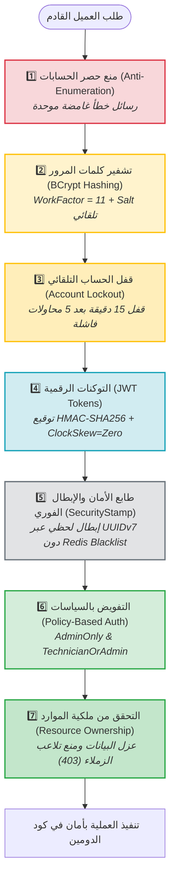

# 🛡️ طبقات الأمان والدفاع في العمق (Defense-in-Depth Security Layers)

> وثيقة مفاهيمية تشرح استراتيجية الأمان الشاملة (Defense-in-Depth) المطبقة في نظام إدارة طلبات الصيانة عبر **سبع طبقات أمان متكاملة** تحمي هوية المستخدمين، تشفر البيانات الحساسة، تمنع هجمات التخمين، وتضمن عزل الصلاحيات وملكية الموارد.

---

## 🏛️ 1. المخطط العام لطبقات الأمان السبع (The 7 Security Layers)

تتضافر طبقات الحماية لحماية النظام من التهديدات الخارجية والداخلية:



---

## 🔍 2. تفصيل طبقات الأمان السبع (The 7 Security Layers)

---

### 🛡️ الطبقة الأولى: منع حصر الحسابات (Anti-Account Enumeration)
- **المبدأ:** حرمان المهاجم من معرفة ما إذا كان اسم مستخدم معين مسجلاً بالنظام أم لا.
- **التطبيق في الكود:**
  - في [`LoginCommandHandler.cs`](file:///C:/Users/KC-PC/source/repos/MaintenanceSystem/src/MaintenanceSystem.Application/Features/Auth/Login/LoginCommandHandler.cs)، يرجع النظام نفس استثناء `UnauthorizedException` ونفس الرسالة:
    `"اسم المستخدم أو كلمة المرور غير صحيحة."`
  - في الحالات الثلاث التالية:
    1. المستخدم غير موجود في قاعدة البيانات إطلاقاً.
    2. المستخدم موجود ولكن حسابه معطل (`IsActive == false`).
    3. المستخدم موجود وكلمة المرور غير مطابقة.
- **الأثر الأمني:** إفشال أدوات التخمين الآلية (Brute Force / Enumeration Tools) ومنع جمع قوائم الموظفين النشطين.

---

### 🔐 الطبقة الثانية: تجزئة كلمات المرور عبر BCrypt (Work Factor = 11)
- **المشروع والملف:** [`BCryptPasswordHasher.cs`](file:///C:/Users/KC-PC/source/repos/MaintenanceSystem/src/MaintenanceSystem.Infrastructure/Security/BCryptPasswordHasher.cs)
- **المعايير المعتمدة:**
  - اعتماد خوارزمية **BCrypt** وفق [ADR-0001](file:///C:/Users/KC-PC/source/repos/MaintenanceSystem/docs/adr/0001-custom-auth.md) مع معامل كلفة حسابية ثابت `WorkFactor = 11`.
  - كل عملية تجزئة تتطلب قرابة $2^{11} = 2048$ جولة حسابية، مما يستغرق قرابة 200 إلى 300 مللي ثانية لكل محاولة.
  - خوارزمية BCrypt تدمج ملح التشفير العشوائي (Cryptographic Salt) تلقائياً داخل الهاش الناتج، مما يلغي الحاجة لعمود Salt منفصل بقاعدة البيانات ويحمي تماماً من هجمات جداول قوس قزح (Rainbow Tables).

---

### 🔒 الطبقة الثالثة: القفل التلقائي للحسابات (Automated Account Lockout)
- **الموقع في الكود:** كينونة الدومين الغنية [`User.cs`](file:///C:/Users/KC-PC/source/repos/MaintenanceSystem/src/MaintenanceSystem.Domain/Entities/User.cs).
- **آلية العمل:**
  1. كل محاولة فاشلة تستدعي الدالة السلوكية `user.RegisterFailedAttempt()`.
  2. يزداد العداد `FailedLoginCount++`.
  3. عند الوصول إلى **5 محاولات فاشلة متتالية**، يتم قفل الحساب تلقائياً:
     `LockoutEndUtc = DateTime.UtcNow.AddMinutes(15)`
  4. أي محاولة لاحقة قبل انقضاء الـ 15 دقيقة تقابل باستجابة **`423 Locked`** دون فحص كلمة المرور.
  5. عند نجاح تسجيل الدخول، يتم استدعاء `user.ResetLockout()` لتصفير العداد وإلغاء القفل.

---

### 🪪 الطبقة الرابعة: التوكنات الرقمية الموقعة (Stateless JWT Tokens)
- **الموقع في الكود:** [`JwtTokenService.cs`](file:///C:/Users/KC-PC/source/repos/MaintenanceSystem/src/MaintenanceSystem.Infrastructure/Security/JwtTokenService.cs) و [`AuthenticationExtensions.cs`](file:///C:/Users/KC-PC/source/repos/MaintenanceSystem/src/MaintenanceSystem.API/Extensions/AuthenticationExtensions.cs).
- **الخصائص والضوابط:**
  - التوقيع بخوارزمية متماثلة قوية `HMAC-SHA256` باستخدام مفتاح سري (`Jwt:SigningKey`) لا يقل طوله عن 256 بت.
  - مدة صلاحية محددة (افتراضياً 60 دقيقة) مخزنة في الحقل `exp`.
  - إلغاء التساهل الزمني تماماً: `ClockSkew = TimeSpan.Zero`، مما يضمن انتهاء صلاحية التوكن في الثانية المحددة له دون انتظار 5 دقائق إضافية كما هو الافتراضي في مكتبات مايكروسوفت.
  - عزل الـ Claims وتوحيد أسمائها القياسية (`sub`, `unique_name`, `email`, `role`, `security_stamp`).

---

### ⚡ الطبقة الخامسة: طابع الأمان والإبطال الفوري للجلسات (UUIDv7 SecurityStamp)
- **المشكلة الشائعة:** توكنات JWT بطبيعتها عديمة الحالة (Stateless)، فإذا سرق التوكن أو تم طرد الموظف أو قام بتغيير كلمة المرور، يظل التوكن فعالاً حتى ينتهي وقته ما لم تُنشئ نظام قوائم سوداء معقد (Blacklist) في Redis.
- **الحل المعتمد في نظامنا:**
  1. يملك كل مستخدم حقلاً فريداً في قاعدة البيانات باسم `SecurityStamp` من نوع **UUIDv7**.
  2. يُضمن هذا الطابع كـ Claim داخل التوكن عند تسجيل الدخول.
  3. في كل طلب HTTP معتمد، يفحص حدث `OnTokenValidated` في خط الأنابيب:
     ```csharp
     if (!string.Equals(user.SecurityStamp.ToString(), securityStampClaim, StringComparison.OrdinalIgnoreCase))
     {
         context.Fail("Unauthorized: Security stamp has changed. Token is revoked.");
     }
     ```
  4. عند تغيير كلمة المرور، أو تغيير أدوار المستخدم، أو تعطيل حسابه، يتم استدعاء `user.UpdateSecurityStamp()` لتوليد طابع جديد، فيبطل فورياً مفعول كافة التوكنات الصادرة سابقاً لهذا المستخدم عبر جميع أجهزته دون الحاجة لكاش خارجي.

---

### 🛡️ الطبقة السادسة: التفويض المعتمد على السياسات (Policy-Based Authorization)
- **الموقع في الكود:** [`AuthorizationExtensions.cs`](file:///C:/Users/KC-PC/source/repos/MaintenanceSystem/src/MaintenanceSystem.API/Authorization/AuthorizationExtensions.cs).
- **السياسات المعتمدة:**
  - **`Policies.MaintenanceAdminOnly`:** تضمن قصر العمليات الإدارية الحساسة (مثل إسناد الفنيين، رفض الطلبات، استعراض كل طلبات المؤسسة) على دور `MaintenanceAdmin`.
  - **`Policies.TechnicianOrAdmin`:** تسمح للفنيين بمتابعة وتحديث حالات الطلبات الميدانية بالإضافة للإدارة.
- **التطبيق الصريح:** استخدام السمات التصريحية `[Authorize(Policy = Policies....)]` على الـ Controllers يمنع تنفيذ أي كود داخلي للطلبات غير المخولة.

---

### 🎯 الطبقة السابعة: التحقق الدقيق من ملكية الموارد (Resource Ownership & Zero-Trust)
- **المبدأ:** امتلاك الدور الصحيح لا يعني بالضرورة امتلاك الحق في تعديل أي سجل.
- **التطبيق الميداني في المعالجات:**
  1. **انعدام الثقة بالواجهة (Zero-Trust Identity):** لا يقبل النظام معرف المستخدم `userId` كمعامل في الـ Body؛ بل يستخرجه حصراً من الـ Claims الموثقة عبر [`ICurrentUserService`](file:///C:/Users/KC-PC/source/repos/MaintenanceSystem/src/MaintenanceSystem.Application/Abstractions/Security/ICurrentUserService.cs).
  2. **فحص الملكية عند التحديث (`UpdateStatus`):**
     - إذا لم يكن المستخدم مديراً (`MaintenanceAdmin`)، يتأكد المعالج من أن الفني المسند للطلب هو نفسه المستخدم الحالي:
       `if (!isAdmin && maintenanceRequest.AssignedTechnicianId != currentUserId) throw new ForbiddenException(...);`
  3. **فحص الملكية عند الاستعلام (`GetById`):**
     - الموظف العادي يرى فقط الطلبات التي أنشأها (`CreatedByUserId == userId`).
     - الفني يرى فقط الطلبات المسندة إليه (`AssignedTechnicianId == userId`).
     - مخالفة ذلك ترجع فوراً استجابة **`403 Forbidden`**.

---

## 📊 3. جدول مقارنة طبقات الأمان والتهديدات المعالجة

| الطبقة الأمنية | نوع الحماية | التهديد المعالج (Threat Mitigated) | الاستجابة عند الانتهاك |
| :--- | :--- | :--- | :--- |
| **1. Anti-Enumeration** | إخفاء الهوية | هجمات حصر وفحص حسابات الموظفين (User Enumeration). | `401 Unauthorized` |
| **2. BCrypt (Cost=11)** | تشفير كلمات المرور | سرقة قاعدة البيانات وهجمات القوة الغاشمة (Brute Force / Rainbow Tables). | `401 Unauthorized` |
| **3. Account Lockout** | حماية الحساب | التخمين الآلي لكلمات المرور (Credential Stuffing). | `423 Locked` |
| **4. JWT (ClockSkew=0)** | توثيق الجلسات | تزييف الهوية والتلاعب بالصلاحيات أو انتهاء الصلاحية. | `401 Unauthorized` |
| **5. SecurityStamp** | إبطال التوكنات | استخدام التوكنات المسروقة بعد تغيير كلمة المرور أو طرد المستخدم. | `401 Unauthorized` |
| **6. Policy Auth** | تخويل الأدوار | وصول الموظفين العاديين لنقاط نهاية الإدارة والفنيين. | `403 Forbidden` |
| **7. Resource Ownership** | ملكية المورد | تلاعب الفنيين بطلبات زملائهم أو اطلاع الموظفين على خصوصية غيرهم. | `403 Forbidden` |

---

## 💡 4. نقاط ذهبية للمعماريين (Golden Security Rules)

> [!TIP]
> - **تذكر قاعدة الـ Zero-Trust:** لا تثق بأي `userId` أو `role` قادم في جسم الطلب أو الـ URL؛ المصدر الوحيد الموثوق هو الـ Claims الموقعة داخل الـ JWT المستخرجة عبر `ICurrentUserService`.
> - **تذكر أهمية `ClockSkew = TimeSpan.Zero`:** القيمة الافتراضية في ASP.NET Core تضيف 5 دقائق تساهل بعد انتهاء التوكن؛ تصفيرها يمنع استغلال التوكنات منتهية الصلاحية.
> - **تذكر أن الـ SecurityStamp يغنيك عن الكاش المعقد:** التحقق من الطابع اللحظي يمنحك مزايا الـ Stateful Sessions الفورية مع الاحتفاظ بخفة المعمارية الـ Stateless.
> - **مشكلة شائعة جداً:** كتابة رسالة "كلمة المرور غير صحيحة" للمستخدم الموجود و"اسم المستخدم غير موجود" للمستخدم غير المسجل؛ هذا الخطأ يكشف بنية المؤسسة للمخترقين ويسهل هجمات التصيد الاحتيالي (Phishing).
