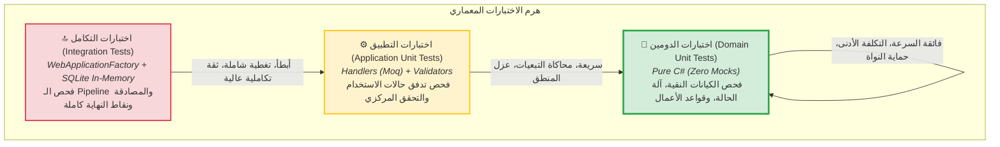

# 🧪 استراتيجية وهرم الاختبارات (Testing Strategy & Test Pyramid)

> وثيقة مفاهيمية تشرح الاستراتيجية الهندسية لاختبار نظام إدارة طلبات الصيانة وفق **هرم الاختبارات (Test Pyramid)**، موضحةً كيفية توزيع الاختبارات عبر الطبقات المختلفة، أدوات الاختبار المعتمدة (xUnit, FluentAssertions, Moq, WebApplicationFactory, SQLite)، وأفضل الممارسات لضمان جودة النظام وصموده أمام التعديلات.

---

## 🔺 1. هرم الاختبارات في النظام (The Test Pyramid)

تتوزع اختبارات المشروع وفق هرم متوازن يجمع بين السرعة القصوى، التكلفة المنخفضة، ومستوى الثقة العالي بالسلوك الميداني:



---

## 🔍 2. تشريح طبقات الاختبار الثلاث (The 3 Testing Layers)

---

### 💎 أ) اختبارات طبقة الدومين (Domain Unit Tests) — قاعدة الهرم
- **المجلد:** [`tests/MaintenanceSystem.Tests/Domain`](file:///C:/Users/KC-PC/source/repos/MaintenanceSystem/tests/MaintenanceSystem.Tests/Domain)
- **الملفات الرئيسية:**
  - [`MaintenanceRequestTests.cs`](file:///C:/Users/KC-PC/source/repos/MaintenanceSystem/tests/MaintenanceSystem.Tests/Domain/MaintenanceRequestTests.cs)
  - [`UserTests.cs`](file:///C:/Users/KC-PC/source/repos/MaintenanceSystem/tests/MaintenanceSystem.Tests/Domain/UserTests.cs)
  - [`MaintenanceTypeTests.cs`](file:///C:/Users/KC-PC/source/repos/MaintenanceSystem/tests/MaintenanceSystem.Tests/Domain/MaintenanceTypeTests.cs)
- **الخصائص والأسلوب:**
  - **صفر محاكاة (Zero Mocks):** لا يُستخدم `Moq` في هذه الطبقة على الإطلاق؛ تُختبر كينونات C# نقية ومباشرة.
  - **فائقة السرعة:** تُنفذ مئات الاختبارات في بضعة أجزاء من الثانية.
  - **ماذا تختبر؟**
    1. صحة منشئات الكيانات وضبط الحالات المبدئية (مثل `Status = New`).
    2. توليد معرفات الإصدار السابع الزمنية السليمة (`UUIDv7`).
    3. مسارات انتقال آلة الحالة السليمة: `New` ➡️ `Assigned` ➡️ `InProgress` ➡️ `Resolved` ➡️ `Closed`.
    4. رمي استثناءات الأعمال عند كسر الشروط: مثل رمي `InvalidStateTransitionException` عند محاولة إغلاق طلب غير معالج، أو رمي `BusinessRuleViolationException` عند تجاوز طول النصوص أو تمرير `Guid.Empty`.
    5. سلوكيات الأمان داخل المستخدم: عداد المحاولات الفاشلة، القفل التلقائي بعد 5 مرات، وإلغاء القفل.

---

### 💼 ب) اختبارات طبقة التطبيق (Application Unit Tests) — وسط الهرم
- **المجلد:** [`tests/MaintenanceSystem.Tests/Application`](file:///C:/Users/KC-PC/source/repos/MaintenanceSystem/tests/MaintenanceSystem.Tests/Application)
- **الأقسام والملفات:**
  - **معالجات الأوامر والاستعلامات (Handlers):**
    - [`LoginCommandHandlerTests.cs`](file:///C:/Users/KC-PC/source/repos/MaintenanceSystem/tests/MaintenanceSystem.Tests/Application/Handlers/LoginCommandHandlerTests.cs)
    - [`CreateMaintenanceRequestCommandHandlerTests.cs`](file:///C:/Users/KC-PC/source/repos/MaintenanceSystem/tests/MaintenanceSystem.Tests/Application/Handlers/CreateMaintenanceRequestCommandHandlerTests.cs)
    - [`RejectMaintenanceRequestCommandHandlerTests.cs`](file:///C:/Users/KC-PC/source/repos/MaintenanceSystem/tests/MaintenanceSystem.Tests/Application/Handlers/RejectMaintenanceRequestCommandHandlerTests.cs)
  - **فئات التحقق (Validators):**
    - [`LoginCommandValidatorTests.cs`](file:///C:/Users/KC-PC/source/repos/MaintenanceSystem/tests/MaintenanceSystem.Tests/Application/Validators/LoginCommandValidatorTests.cs)
    - [`CreateMaintenanceRequestCommandValidatorTests.cs`](file:///C:/Users/KC-PC/source/repos/MaintenanceSystem/tests/MaintenanceSystem.Tests/Application/Validators/CreateMaintenanceRequestCommandValidatorTests.cs)
    - [`UpdateMaintenanceRequestStatusCommandValidatorTests.cs`](file:///C:/Users/KC-PC/source/repos/MaintenanceSystem/tests/MaintenanceSystem.Tests/Application/Validators/UpdateMaintenanceRequestStatusCommandValidatorTests.cs)
- **الخصائص والأسلوب:**
  - **عزل التبعيات الخارجية عبر `Moq`:** يتم محاكاة المستودعات (`IUserRepository`, `IMaintenanceRequestRepository`) والخدمات (`ICurrentUserService`, `IPasswordHasher`, `ITokenService`).
  - **ماذا تختبر؟**
    1. تنسيق التدفق الصحيح لحالات الاستخدام وحفظ النتائج في المستودعات.
    2. التحقق من صلاحية الهوية ورمي `UnauthorizedException` أو `ForbiddenException` عند غياب الصلاحيات أو انتهاك ملكية المورد.
    3. فحص حدود المدخلات في فئات التحقق (Validation Rules) وضمان رفض النصوص الطويلة أو الفارغة ومعاملات الترقيم الخاطئة.

---

### 🌐 ج) اختبارات التكامل (Integration Tests) — قمة الهرم
- **المجلد:** [`tests/MaintenanceSystem.Tests/Integration`](file:///C:/Users/KC-PC/source/repos/MaintenanceSystem/tests/MaintenanceSystem.Tests/Integration)
- **الملفات الرئيسية:**
  - مصنع الخادم الوهمي: [`CustomWebApplicationFactory.cs`](file:///C:/Users/KC-PC/source/repos/MaintenanceSystem/tests/MaintenanceSystem.Tests/Integration/CustomWebApplicationFactory.cs)
  - اختبارات المصادقة: [`AuthEndpointsTests.cs`](file:///C:/Users/KC-PC/source/repos/MaintenanceSystem/tests/MaintenanceSystem.Tests/Integration/AuthEndpointsTests.cs)
  - اختبارات الطلبات: [`MaintenanceRequestEndpointsTests.cs`](file:///C:/Users/KC-PC/source/repos/MaintenanceSystem/tests/MaintenanceSystem.Tests/Integration/MaintenanceRequestEndpointsTests.cs)
- **الخصائص والأسلوب:**
  - **خادم حقيقي في الذاكرة (`TestServer`):** استدعاء حقيقي لنقاط النهاية عبر بروتوكول HTTP باستخدام `HttpClient`.
  - **استبدال قاعدة البيانات بـ `SQLite In-Memory`:** استبدال اتصال SQL Server الحقيقي بقاعدة بيانات علائقية سريعة ومستقلة تعمل في الذاكرة أثناء وقت الاختبار وتُبنى جداولها لحظياً عبر `EnsureCreated()`.
  - **ماذا تختبر؟**
    1. خط الأنابيب بالكامل (ExceptionHandlingMiddleware, Routing, Jwt Authentication, Authorization Policies).
    2. تدفق تسجيل الدخول وتوليد التوكن ثم استخدام التوكن في ترويسة الطلبات اللاحقة.
    3. فحص استجابات ProblemDetails برموزها الصحيحة (200, 201, 400, 401, 403, 404, 423).

---

## 🛠️ 3. حزمة أدوات الاختبار المعتمدة (Testing Toolset)

تعتمد حزمة الاختبارات في [`MaintenanceSystem.Tests.csproj`](file:///C:/Users/KC-PC/source/repos/MaintenanceSystem/tests/MaintenanceSystem.Tests/MaintenanceSystem.Tests.csproj) على الأدوات الخمس الفعلية التالية:

| الأداة / الحزمة (Tool) | الإصدار | دورها في معمارية الاختبار |
| :--- | :--- | :--- |
| **`xUnit`** | `2.9.3` | إطار عمل تشغيل الاختبارات الرئيسي (Test Runner) باستخدام السمات `[Fact]` و `[Theory]`. |
| **`FluentAssertions`** | `8.0.1` | مكتبة تأكيدات تعبيرية وقابلة للقراءة البشرية الفائقة (مثل `result.Status.Should().Be(New)`). |
| **`Moq`** | `4.20.72` | مكتبة محاكاة الواجهات المجردة والخدمات في اختبارات طبقة التطبيق (`Mock<IRepository>`). |
| **`Microsoft.AspNetCore.Mvc.Testing`** | `10.0.13` | توفير فئة `WebApplicationFactory` لتشغيل تطبيق الـ API كاملاً في الذاكرة لاختبارات التكامل. |
| **`Microsoft.EntityFrameworkCore.Sqlite`** | `10.0.13` | توفير محرك قاعدة بيانات SQLite في الذاكرة لدعم استعلامات EF Core في اختبارات التكامل دون الحاجة لخادم خارجي. |

> [!NOTE]
> **أدوات التغطية البرمجية (Code Coverage Tools):**
> يمكن مستقبلاً ربط أدوات قياس التغطية مثل `Coverlet` أو تقارير `ReportGenerator` ضمن مسار النشر المستمر (CI/CD Pipeline) لقياس نسبة التغطية التراكمية للكود.

---

## 📝 4. أفضل الممارسات وقواعد كتابة الاختبارات (Testing Best Practices)

### 1️⃣ نمط الترتيب الثلاثي (The AAA Pattern: Arrange - Act - Assert)
يجب فصل كل دالة اختبار بوضوح إلى ثلاثة أقسام مميزة:
```csharp
[Fact]
public void AssignTechnician_ShouldTransitionToAssigned_WhenStatusIsNew()
{
    // 1. Arrange: تهيئة البيانات والمدخلات
    var request = new MaintenanceRequest("عطل", "وصف المشكلة", MaintenancePriority.Medium, Guid.NewGuid(), Guid.NewGuid());
    var techId = Guid.NewGuid();

    // 2. Act: تنفيذ السلوك المطلوب اختباره
    request.AssignTechnician(techId);

    // 3. Assert: التحقق من النتيجة المتوقعة عبر FluentAssertions
    request.Status.Should().Be(MaintenanceRequestStatus.Assigned);
    request.AssignedTechnicianId.Should().Be(techId);
    request.AssignedAtUtc.Should().NotBeNull();
}
```

---

### 2️⃣ التسمية المعيارية الدقيقة للاختبارات (Naming Convention)
تتبع أسماء دوال الاختبار الصيغة الصريحة الثلاثية:
`[UnitOfWork]_[ExpectedBehavior]_[Condition]`
- **أمثلة:**
  - `Handle_ShouldReturnToken_WhenCredentialsAreValid()`
  - `Handle_ShouldThrowLockedException_WhenAccountIsLockedOut()`
  - `Start_ShouldThrowInvalidStateTransitionException_WhenStatusIsNotAssigned()`

---

### 3️⃣ استقلالية وعزل الاختبارات (Test Isolation & Clean State)
- لا يعتمد أي اختبار على نتائج اختبار آخر.
- في اختبارات التكامل، يتم إنشاء سياق اتصال SQLite جديد أو تنظيف الجداول لضمان بدء كل اختبار ببيانات نقية لا تتأثر بالعمليات السابقة.

---

### 4️⃣ لا تقم بمحاكاة كينونات الدومين (Never Mock Domain Entities)
- المحاكاة عبر `Moq` مخصصة للواجهات المجردة والخدمات الخارجية فقط (`IMaintenanceRequestRepository`, `ITokenService`).
- كينونات الدومين تُنشأ دائماً ككائنات حقيقية (`new MaintenanceRequest(...)`) لضمان اختبار قواعد العمل الفعلية.

---

## 💡 5. نقاط ذهبية للمطورين (Golden Architecture Takeaways)

> [!TIP]
> - **تذكر قاعدة السرعة:** اختبارات الدومين يجب أن تظل خالية من أي عمليات I/O أو قواعد بيانات؛ سرعتها الفائقة هي ما يشجع المطورين على تشغيلها باستمرار أثناء التطوير التكراري (TDD).
> - **تذكر ألا تختبر مايكروسوفت (Don't test the framework):** لا تكتب اختبارات لتتأكد من أن EF Core يستطيع حفظ السجلات، بل اختبر استعلاماتك وتخصيصاتك وقواعد عملك فقط.
> - **تذكر أن تفشل أولاً (Assert on Failures):** كما تختبر مسار النجاح (Happy Path)، تأكد دائماً من اختبار كافة سيناريوهات الفشل (رمي `400`, `401`, `403`, `404`) للتأكد من صمود النظام أمام المدخلات الخبيثة أو الخاطئة.
> - **أمر التشغيل المعتمد:** قبل أي Commit، شغّل دائماً من المجلد الرئيسي للمشروع:
>   ```powershell
>   dotnet test
>   ```
