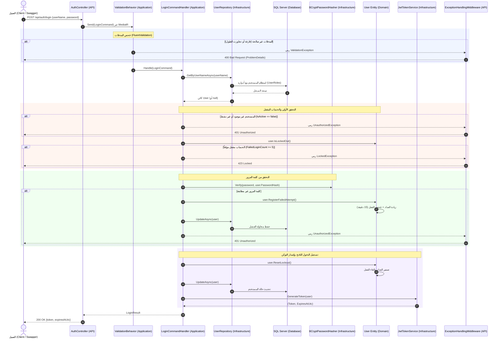
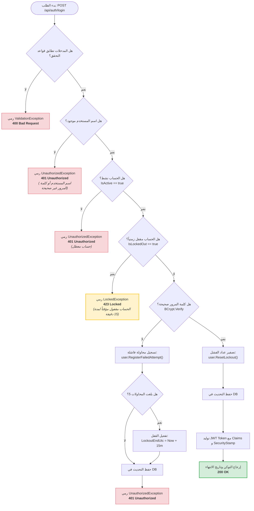

# 🔐 رحلة تسجيل الدخول (Login Flow)

> وثيقة تعليمية تفصيلية تشرح دورة حياة طلب تسجيل الدخول (Authentication) في نظام إدارة طلبات الصيانة من الصفر وحتى إصدار التوكن أو رفض الطلب، وفق معمارية البصلة (Onion Architecture) ونمط الوسيط (CQRS / MediatR).

---

## 🌐 1. واجهة الطلب (HTTP Request Contract)

يتم إرسال طلب تسجيل الدخول عبر بروتوكول HTTP POST إلى نقطة النهاية المفتوحة (Anonymous Endpoint).

### 📝 مواصفات الطلب (Endpoint Spec)
- **Method:** `POST`
- **Route:** `/api/auth/login`
- **Headers:** `Content-Type: application/json`
- **Authentication:** لا يتطلب توكن مسبق (`AllowAnonymous`).

### 📦 جسم الطلب (Request Payload)
```json
{
  "userName": "tech.ahmed",
  "password": "Password123!"
}
```

### 🔨 استدعاء مباشر (cURL Example)
```bash
curl -X POST "http://localhost:5000/api/auth/login" \
     -H "Content-Type: application/json" \
     -d '{"userName":"tech.ahmed","password":"Password123!"}'
```

### 📤 الاستجابة الناجحة المتوقعة (200 OK Response)
```json
{
  "token": "eyJhbGciOiJIUzI1NiIsInR5cCI6IkpXVCJ9...",
  "expiresAtUtc": "2026-10-16T22:45:00Z"
}
```

> [!NOTE]
> **لماذا لا نستخدم `ASP.NET Core Identity`؟**
> تم بناء نظام المصادقة خصيصاً (Custom Auth) وفق [ADR-0001](file:///C:/Users/KC-PC/source/repos/MaintenanceSystem/docs/adr/0001-custom-auth.md) لتجنب الجداول المعقدة المفروضة من مايكروسوفت (`AspNetUsers`, `AspNetRoles`...) والحفاظ على نموذج كينونات الدومين نقياً ومستقلاً تماماً تحت سيطرتنا الكاملة.

---

## 🔄 2. المخطط التتابعي الكامل (Sequence Diagram)

يوضح المخطط التالي انتقال الطلب عبر طبقات النظام المختلفة:



---

## 🚉 3. المحطات الست في رحلة الريكوست (The 6 Stations)

### 1️⃣ المحطة الأولى: البوابة واستلام الطلب (Client & Controller)
- **الملف الفعلي:** [`AuthController.cs`](file:///C:/Users/KC-PC/source/repos/MaintenanceSystem/src/MaintenanceSystem.API/Controllers/AuthController.cs)
- **الدالة:** `Login([FromBody] LoginRequest request, CancellationToken cancellationToken)`
- **ماذا يحدث هنا؟**
  1. يقوم إطار عمل ASP.NET Core بعمل Deserialization لجسم الـ JSON وتحويله إلى كائن [`LoginRequest`](file:///C:/Users/KC-PC/source/repos/MaintenanceSystem/src/MaintenanceSystem.API/Contracts/Auth/LoginRequest.cs).
  2. لا توجد أي معالجة لمنطق الأعمال داخل الـ Controller؛ دوره يقتصر على تغليف المدخلات داخل أمر [`LoginCommand`](file:///C:/Users/KC-PC/source/repos/MaintenanceSystem/src/MaintenanceSystem.Application/Features/Auth/Login/LoginCommand.cs) وإرساله عبر الوسيط `_sender.Send(...)`.

> [!TIP]
> **نقطة ذهبية (Thin Controllers):**
> الـ Controller مجرد مترجم بروتوكول (HTTP Adapter)؛ لا يحتوي على `try/catch`، ولا يتحقق من صحة القواعد، ولا يتصل بقاعدة البيانات مباشرة.

---

### 2️⃣ المحطة الثانية: جدار الصلاحية التلقائي (Pipeline Behavior & Validation)
- **الملفات الفعلية:**
  - خط أنابيب التحقق: [`ValidationBehavior.cs`](file:///C:/Users/KC-PC/source/repos/MaintenanceSystem/src/MaintenanceSystem.Application/Common/Behaviors/ValidationBehavior.cs)
  - قواعد التحقق: [`LoginCommandValidator.cs`](file:///C:/Users/KC-PC/source/repos/MaintenanceSystem/src/MaintenanceSystem.Application/Features/Auth/Login/LoginCommandValidator.cs)
- **ماذا يحدث هنا؟**
  - قبل أن يصل الأمر إلى المعالج (`Handler`)، يمر عبر وسيط التحقق في MediatR Pipeline.
  - يفحص الشروط الآتية:
    1. `UserName`: لا يمكن أن يكون فارغاً، وبحد أقصى 50 محرفاً.
    2. `Password`: لا يمكن أن تكون فارغة، وبحد أقصى 128 محرفاً.
  - إذا فشل أي شرط، يتوقف المسار فوراً ويتم رمي `ValidationException` دون إزعاج قاعدة البيانات.

---

### 3️⃣ المحطة الثالثة: البحث عن المستخدم (Repository & EF Core)
- **الملفات الفعلية:**
  - الواجهة: [`IUserRepository.cs`](file:///C:/Users/KC-PC/source/repos/MaintenanceSystem/src/MaintenanceSystem.Application/Abstractions/Persistence/IUserRepository.cs)
  - التنفيذ: [`UserRepository.cs`](file:///C:/Users/KC-PC/source/repos/MaintenanceSystem/src/MaintenanceSystem.Infrastructure/Persistence/Repositories/UserRepository.cs)
- **الدالة:** `GetByUserNameAsync(string userName, CancellationToken cancellationToken)`
- **ماذا يحدث هنا؟**
  - الاستعلام يجلب بيانات الحساب مع جدول الأدوار عبر علاقة `Include(u => u.UserRoles).ThenInclude(ur => ur.Role)`.
  - إذا كان المستخدم غير موجود في النظام إطلاقاً، أو كانت خاصية `IsActive == false`، يتم رمي استثناء `UnauthorizedException` فوراً.

> [!IMPORTANT]
> **الأمان ومنع التخمين (Anti-Enumeration Defense):**
> سواء كان اسم المستخدم غير موجود، أو الحساب معطلاً، أو كلمة المرور خاطئة، يرجع النظام نفس الرسالة الغامضة: *"اسم المستخدم أو كلمة المرور غير صحيحة."* لمنع المهاجمين من حصر أسماء الموظفين النشطين في المؤسسة.

---

### 4️⃣ المحطة الرابعة: المنطق السلوكي للأمان والقفل (Domain Security & BCrypt)
- **الملفات الفعلية:**
  - معالج الأمر: [`LoginCommandHandler.cs`](file:///C:/Users/KC-PC/source/repos/MaintenanceSystem/src/MaintenanceSystem.Application/Features/Auth/Login/LoginCommandHandler.cs)
  - كينونة المستخدم: [`User.cs`](file:///C:/Users/KC-PC/source/repos/MaintenanceSystem/src/MaintenanceSystem.Domain/Entities/User.cs)
  - مشفر كلمات المرور: [`BCryptPasswordHasher.cs`](file:///C:/Users/KC-PC/source/repos/MaintenanceSystem/src/MaintenanceSystem.Infrastructure/Security/BCryptPasswordHasher.cs)
- **الخطوات الدقيقة:**
  1. **فحص القفل الزمني (`user.IsLockedOut()`):**
     إذا كان الحساب مقفولاً وما زال الوقت الحالي قبل `LockoutEndUtc`، يرمي النظام `LockedException` برمز `423 Locked`.
  2. **التحقق من الهاش (`_passwordHasher.Verify`):**
     مقارنة كلمة المرور الصريحة مع الهاش المخزن في الحقل `PasswordHash`.
  3. **في حالة الفشل:**
     استدعاء دالة الدومين السلوكية `user.RegisterFailedAttempt()`:
     - زيادة العداد `FailedLoginCount++`.
     - عند وصول المحاولات إلى 5، يتم ضبط القفل التلقائي: `LockoutEndUtc = UtcNow.AddMinutes(15)`.
     - حفظ التحديث عبر `_userRepository.UpdateAsync(user)` ورمي `UnauthorizedException`.
  4. **في حالة النجاح:**
     استدعاء دالة `user.ResetLockout()` لتصفير عداد المحاولات الفاشلة وإلغاء أي وقت قفل سابق، ثم حفظ التحديث في قاعدة البيانات.

> [!NOTE]
> **لماذا الدوال السلوكية في الدومين؟ (Rich Domain Model)**
> تماشياً مع قواعد المشروع الصارمة، لا يقوم الـ Handler بحساب مدة القفل بنفسه، بل تخضع قواعد الأعمال بالكامل لسلطة كينونة `User` لحماية منطق النظام من التكرار أو التجاوز.

---

### 5️⃣ المحطة الخامسة: إصدار التوكن الرقمي (JWT Token Generation)
- **الملف الفعلي:** [`JwtTokenService.cs`](file:///C:/Users/KC-PC/source/repos/MaintenanceSystem/src/MaintenanceSystem.Infrastructure/Security/JwtTokenService.cs)
- **الدالة:** `GenerateToken(User user)`
- **ماذا يحدث هنا؟**
  - يتم تشفير وتوقيع التوكن بمفتاح سري متماثل عبر خوارزمية `HMAC-SHA256`.
  - يتم تضمين الـ Claims الآتية:
    - معرف المستخدم (`sub`, `nameid`).
    - اسم المستخدم (`unique_name`).
    - البريد الإلكتروني (`email`).
    - الدور الأساسي للمستخدم (`role`) (مثل `Manager`, `Technician`, `Employee`).
    - طابع الأمان الفريد (`security_stamp`) من نوع **UUIDv7**.
  - يتم حساب وقت انتهاء الصلاحية بناءً على الإعدادات المسجلة في `JwtOptions` (افتراضياً 60 دقيقة).

---

### 6️⃣ المحطة السادسة: مخرج الاستجابة ومعالجة الأخطاء (Middleware & Response)
- **الملف الفعلي:** [`ExceptionHandlingMiddleware.cs`](file:///C:/Users/KC-PC/source/repos/MaintenanceSystem/src/MaintenanceSystem.API/Middleware/ExceptionHandlingMiddleware.cs)
- **ماذا يحدث هنا؟**
  - في حال النجاح، يستلم `AuthController` كائن `LoginResult` ويغلفه داخل `LoginResponse` مع رمز الحالة `200 OK`.
  - في حال حدوث أي خطأ، تلتقط وسيطة `ExceptionHandlingMiddleware` الاستثناء وتحوله إلى كائن معتمد لمواصفة RFC 7807 (`ProblemDetails`).

---

## 🌳 4. شجرة القرار الكاملة (Decision Tree)

توضح شجرة القرار كافة الاحتمالات الممكنة عند تقديم طلب تسجيل الدخول:



---

## ⚠️ 5. مصفوفة الاستثناءات وحالات الخطأ (Exceptions Matrix)

تتعامل وسيطة [`ExceptionHandlingMiddleware.cs`](file:///C:/Users/KC-PC/source/repos/MaintenanceSystem/src/MaintenanceSystem.API/Middleware/ExceptionHandlingMiddleware.cs) مركزياً مع كافة الاستثناءات الناتجة:

| رمز الحالة (Status) | الاستثناء البرمجي (Exception) | السبب المباشر (Trigger) | شكل الاستجابة (ProblemDetails Format) |
| :--- | :--- | :--- | :--- |
| **`400 Bad Request`** | `ValidationException` | اسم المستخدم فارغ أو كلمة المرور تتجاوز 128 محرفاً | `{"status": 400, "title": "Validation Error", "validationErrors": {"UserName": [...]}}` |
| **`401 Unauthorized`** | `UnauthorizedException` | 1. اسم المستخدم غير موجود.<br>2. الحساب معطل (`IsActive = false`).<br>3. كلمة المرور غير صحيحة. | `{"status": 401, "title": "Unauthorized", "detail": "اسم المستخدم أو كلمة المرور غير صحيحة."}` |
| **`423 Locked`** | `LockedException` | تجاوز 5 محاولات خاطئة ولم تنتهِ فترة الـ 15 دقيقة | `{"status": 423, "title": "Locked", "detail": "الحساب مقفول مؤقتاً لتكرار محاولات الدخول الخاطئة..."}` |
| **`500 Internal Error`**| `Exception` غير معالج | انقطاع الاتصال بقاعدة البيانات أو خطأ غير متوقع | `{"status": 500, "title": "Internal Server Error", "detail": "An unhandled error occurred."}` |

---

## 🪪 6. تشريح التوكن الرقمي (JWT Claims Anatomy)

عند فك تشفير التوكن الناتج عبر [jwt.io](https://jwt.io)، نجد هيكل الـ Claims التالي:

```json
{
  "sub": "01925b42-d610-7389-9d7a-123456789abc",
  "nameid": "01925b42-d610-7389-9d7a-123456789abc",
  "unique_name": "tech.ahmed",
  "email": "ahmed@example.com",
  "role": "Technician",
  "security_stamp": "01925b42-d615-7a42-9988-aabbccddeeff",
  "nbf": 1729115100,
  "exp": 1729118700,
  "iat": 1729115100,
  "iss": "MaintenanceSystemAPI",
  "aud": "MaintenanceSystemClients"
}
```

### 🔍 تفاصيل الحقول الحرجة:
- **`sub` / `nameid`:** المعرف الفريد للمستخدم في قاعدة البيانات (UUIDv7).
- **`role`:** الدور الوظيفي للمستخدم ويُستخدم للتحقق عبر السمات `[Authorize(Roles = "...")]`.
- **`security_stamp`:** قيمة فريدة تتغير فورياً عند تغيير كلمة المرور أو تعطيل الحساب؛ تُستخدم لإبطال مفعول التوكن الحالي حتى وإن كان تاريخ انتهائه مستقبلياً.

---

## 🛡️ 7. طبقات الأمان المطبقة في هذا المسار (Security Layers)

1. **إخفاء هوية الحسابات (Account Enumeration Prevention):**
   عدم الإفصاح عما إذا كان الحساب موجوداً أم لا عند فشل الدخول لتضليل المخترقين.
2. **تشفير قوي ببطء مقصود (BCrypt Hashing):**
   استخدام دالة التجزئة التكرارية BCrypt ذات كلفة الحساب العالية لمقاومة هجمات القوة الغاشمة (Brute Force).
3. **الحماية التلقائية من الهجمات المتكررة (Auto Account Lockout):**
   القفل الفوري لمدة 15 دقيقة بعد 5 محاولات فاشلة متتالية مسجلة في قاعدة البيانات.
4. **طابع الأمان الإصدار السابع (UUIDv7 Security Stamp):**
   تمكين الإبطال اللحظي للجلسات دون الحاجة إلى التخزين الدائم للتوكنات في خادم الذاكرة.

---

## 🧪 8. كيفية اختبار المسار (Testing Guide)

### أ) اختبارات الوحدة (Unit Tests)
- [`LoginCommandHandlerTests.cs`](file:///C:/Users/KC-PC/source/repos/MaintenanceSystem/tests/MaintenanceSystem.Tests/Application/Handlers/LoginCommandHandlerTests.cs):
  - تجربة نجاح تسجيل الدخول بالحساب الصحيح.
  - تجربة فشل تسجيل الدخول عند إدخال كلمة مرور خاطئة.
  - تجربة زيادة العداد وقفل الحساب عند المحاولة الخامسة.
- [`LoginCommandValidatorTests.cs`](file:///C:/Users/KC-PC/source/repos/MaintenanceSystem/tests/MaintenanceSystem.Tests/Application/Validators/LoginCommandValidatorTests.cs):
  - التحقق من رفض الحقول الفارغة أو الطويلة.
- [`UserTests.cs`](file:///C:/Users/KC-PC/source/repos/MaintenanceSystem/tests/MaintenanceSystem.Tests/Domain/UserTests.cs):
  - اختبار دوال الدومين السلوكية `RegisterFailedAttempt` و `ResetLockout` و `IsLockedOut`.

### ب) اختبارات التكامل (Integration Tests)
- [`AuthEndpointsTests.cs`](file:///C:/Users/KC-PC/source/repos/MaintenanceSystem/tests/MaintenanceSystem.Tests/Integration/AuthEndpointsTests.cs):
  - إرسال طلب HTTP حقيقي عبر `WebApplicationFactory`.
  - التأكد من إرجاع رمز `200 OK` والتوكن السليم.
  - التأكد من إرجاع `423 Locked` عند تكرار 5 محاولات خاطئة متتالية.

### ج) الفحص اليدوي السريع عبر PowerShell
```powershell
$body = @{ userName = "admin"; password = "AdminPassword123!" } | ConvertTo-Json
$response = Invoke-RestMethod -Uri "http://localhost:5000/api/auth/login" -Method Post -Body $body -ContentType "application/json"
$response.token
```

---

## 💡 9. نقاط ذهبية للتذكر (Golden Architecture Takeaways)

> [!TIP]
> - **تذكر:** في المعمارية النظيفة، لا يعلم الـ `Application Layer` أي شيء عن `HttpContext` أو `ClaimsPrincipal`.
> - **تذكر:** لا تثق بأي قيمة مرسلة من واجهة المستخدم، حتى طول النصوص يتم فحصه على طبقة `FluentValidation`.
> - **تذكر:** تغيير كلمة المرور يجب أن يولد `SecurityStamp` جديداً لضمان خروج كافة الأجهزة المسجلة.
> - **مشكلة حقيقية شائعة:** كتابة منطق احتساب وقت انتهاء القفل `now.AddMinutes(15)` داخل الـ Controller أو الـ Handler؛ الحل الصحيح هو إبقاء هذه العملية داخل كينونة `User` في الـ Domain لضمان تماسك حالة الكائن وعدم تجاوزه.
