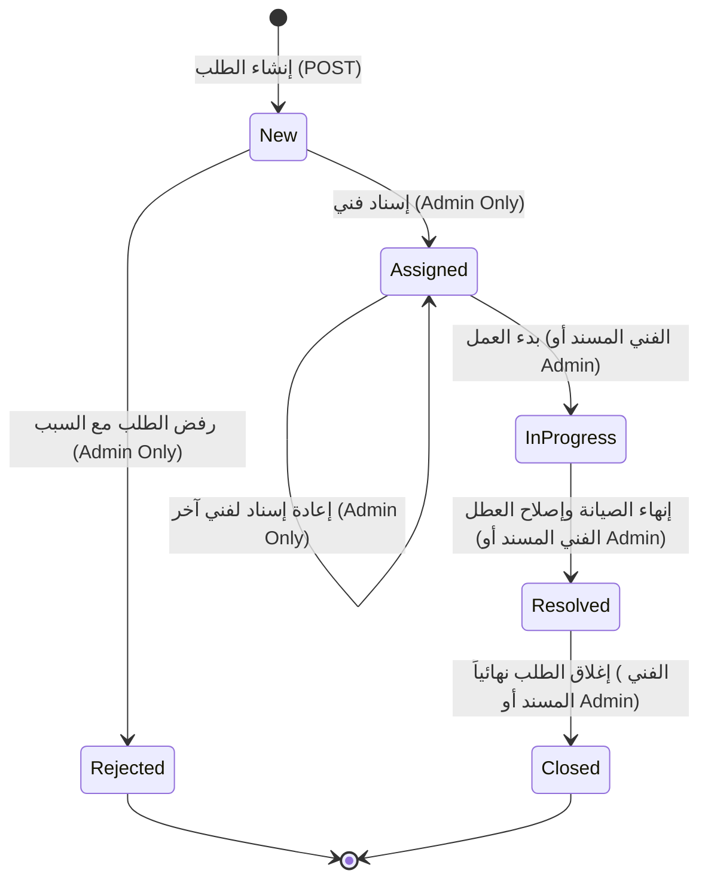
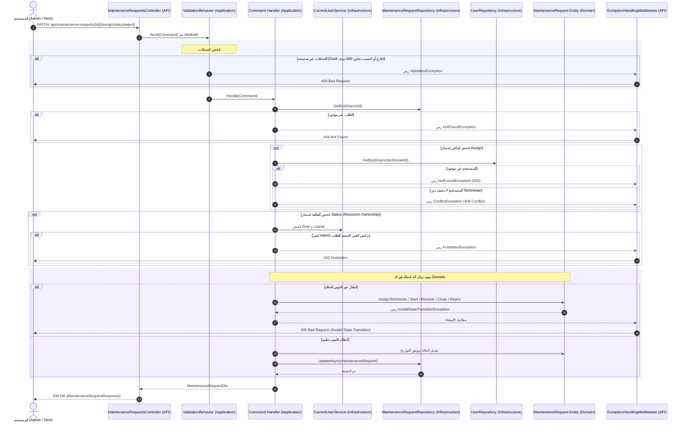
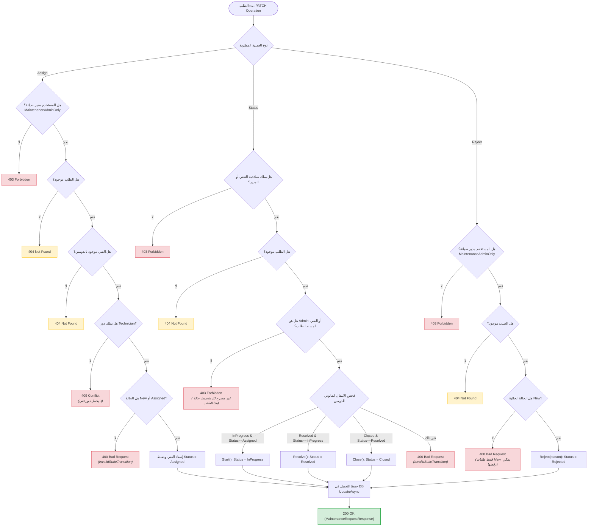

# 🔄 دورة حياة طلب الصيانة (Lifecycle Operations)

> وثيقة تعليمية تفصيلية تشرح دورة حياة طلب الصيانة بعد إنشائه، متضمنةً المسارات الفرعية الثلاثة: إسناد الفني (`Assign`)، تحديث حالة الإنجاز (`Status`)، ورفض الطلب (`Reject`)، مع التركيز على آلة الحالة المدمجة (State Machine) وقواعد ملكية الموارد (Resource Ownership).

---

## 🧭 1. آلة حالة طلب الصيانة (State Machine)

تخضع كل كينونة [`MaintenanceRequest`](file:///C:/Users/KC-PC/source/repos/MaintenanceSystem/src/MaintenanceSystem.Domain/Entities/MaintenanceRequest.cs) لآلة حالة صارمة تحمي انتقال دورة العمل وتمنع القفز العشوائي بين الحالات:



> [!IMPORTANT]
> **قاعدة الانتقال الصارم (Strict Transitions):**
> أي محاولة لنقل الطلب إلى حالة غير مسموح بها برمجياً تؤدي فوراً إلى رمي [`InvalidStateTransitionException`](file:///C:/Users/KC-PC/source/repos/MaintenanceSystem/src/MaintenanceSystem.Domain/Exceptions/InvalidStateTransitionException.cs) وترجمتها إلى استجابة **`400 Bad Request`** بصيغة ProblemDetails.

---

## 🔀 2. المسارات الفرعية الثلاثة (The 3 Sub-Flows)

---

### 🔹 المسار الفرعي الأول: إسناد فني (Assign Technician)

#### 📝 مواصفات الطلب (Endpoint Spec)
- **Method:** `PATCH`
- **Route:** `/api/maintenance-requests/{id}/assign`
- **Authorization:** `[Authorize(Policy = Policies.MaintenanceAdminOnly)]`
- **جسم الطلب (Request Payload):**
```json
{
  "technicianId": "01925b42-d610-7389-9d7a-222233334444"
}
```

#### 🔨 استدعاء مباشر (cURL Example)
```bash
curl -X PATCH "http://localhost:5000/api/maintenance-requests/01925b50-1234-789a-bcde-fedcba987654/assign" \
     -H "Content-Type: application/json" \
     -H "Authorization: Bearer <ADMIN_JWT_TOKEN>" \
     -d '{"technicianId":"01925b42-d610-7389-9d7a-222233334444"}'
```

#### 🚉 محطات المسار (Stations):
1. **Controller Gate:** يتحقق من سياسة `MaintenanceAdminOnly`؛ إذا كان المستخدم لا يحمل دور مدير صيانة، يُرد بـ `403 Forbidden`. يغلف المعرفات في [`AssignTechnicianCommand`](file:///C:/Users/KC-PC/source/repos/MaintenanceSystem/src/MaintenanceSystem.Application/Features/MaintenanceRequests/AssignTechnician/AssignTechnicianCommand.cs).
2. **Validation:** يفحص [`AssignTechnicianCommandValidator`](file:///C:/Users/KC-PC/source/repos/MaintenanceSystem/src/MaintenanceSystem.Application/Features/MaintenanceRequests/AssignTechnician/AssignTechnicianCommandValidator.cs) أن `RequestId` و `TechnicianId` ليسا فارغين (`Guid.Empty` مرفوض).
3. **Request Lookup:** يستعلم المعالج [`AssignTechnicianCommandHandler.cs`](file:///C:/Users/KC-PC/source/repos/MaintenanceSystem/src/MaintenanceSystem.Application/Features/MaintenanceRequests/AssignTechnician/AssignTechnicianCommandHandler.cs) عن طلب الصيانة عبر `_requestRepository.GetByIdAsync`. إذا لم يُعثر عليه، يُرمى `NotFoundException` (404).
4. **Technician Lookup & Role Check:** يستعلم عن حساب المستخدم عبر [`IUserRepository`](file:///C:/Users/KC-PC/source/repos/MaintenanceSystem/src/MaintenanceSystem.Application/Abstractions/Persistence/IUserRepository.cs). إذا لم يُعثر عليه يُرمى `NotFoundException`. وإذا كان المستخدم موجوداً لكنه لا يحمل دور `Technician`، يُرمى `ConflictException` (409).
5. **Domain Execution & Persistence:** تستدعي الكينونة الدالة السلوكية `maintenanceRequest.AssignTechnician(technicianId)`. تفحص الدالة أن الحالة إما `New` أو `Assigned` (تسمح بإعادة الإسناد). يتم ضبط `AssignedTechnicianId` و `AssignedAtUtc` و `Status = Assigned`، ثم حفظ التعديل عبر `_requestRepository.UpdateAsync`.

---

### 🔹 المسار الفرعي الثاني: تحديث حالة الطلب (Update Status)

#### 📝 مواصفات الطلب (Endpoint Spec)
- **Method:** `PATCH`
- **Route:** `/api/maintenance-requests/{id}/status`
- **Authorization:** `[Authorize(Policy = Policies.TechnicianOrAdmin)]`
- **جسم الطلب (Request Payload):**
```json
{
  "newStatus": 2
}
```

> [!NOTE]
> **قيم حالات التحديث المسموح بها عبر هذا المسار:**
> - `2`: `InProgress` (بدء العمل على الطلب).
> - `3`: `Resolved` (تم حل المشكلة وتوثيق وقت المعالجة).
> - `4`: `Closed` (إغلاق الطلب نهائياً).

#### 🔨 استدعاء مباشر (cURL Example)
```bash
curl -X PATCH "http://localhost:5000/api/maintenance-requests/01925b50-1234-789a-bcde-fedcba987654/status" \
     -H "Content-Type: application/json" \
     -H "Authorization: Bearer <TECH_OR_ADMIN_JWT_TOKEN>" \
     -d '{"newStatus": 2}'
```

#### 🚉 محطات المسار (Stations):
1. **Controller Gate:** فحص سياسة `TechnicianOrAdmin` على مستوى إطار العمل.
2. **Resource Ownership Verification (المحطة الحرجة):**
   - يستعلم المعالج [`UpdateMaintenanceRequestStatusCommandHandler.cs`](file:///C:/Users/KC-PC/source/repos/MaintenanceSystem/src/MaintenanceSystem.Application/Features/MaintenanceRequests/UpdateMaintenanceRequestStatus/UpdateMaintenanceRequestStatusCommandHandler.cs) عن الطلب من المستودع.
   - يفحص دور المستخدم الحالي عبر [`ICurrentUserService`](file:///C:/Users/KC-PC/source/repos/MaintenanceSystem/src/MaintenanceSystem.Application/Abstractions/Security/ICurrentUserService.cs).
   - إذا لم يكن المستخدم `MaintenanceAdmin`، **يجب** أن يكون هو الفني المسند للطلب شخصياً (`maintenanceRequest.AssignedTechnicianId == currentUserId`)، وإلا يُرمى استثناء [`ForbiddenException`](file:///C:/Users/KC-PC/source/repos/MaintenanceSystem/src/MaintenanceSystem.Application/Common/Exceptions/ForbiddenException.cs) برمز **`403 Forbidden`**.
3. **State Machine Dispatcher:** يوجه الـ Handler الانتقال المطلوب إلى الدالة السلوكية المخصصة داخل الدومين:
   - `InProgress` ⬅️ يستدعي `maintenanceRequest.Start()` (يشترط أن تكون الحالة السابقة `Assigned`).
   - `Resolved` ⬅️ يستدعي `maintenanceRequest.Resolve()` (يشترط أن تكون الحالة السابقة `InProgress`، ويضبط `ResolvedAtUtc`).
   - `Closed` ⬅️ يستدعي `maintenanceRequest.Close()` (يشترط أن تكون الحالة السابقة `Resolved`، ويضبط `ClosedAtUtc`).
   - أي حالة أخرى ⬅️ رمي `InvalidStateTransitionException` برمز `400 Bad Request`.
4. **Persistence:** حفظ الكينونة المحدثة عبر المستودع وإرجاع كائن DTO المحدث.

---

### 🔹 المسار الفرعي الثالث: رفض الطلب (Reject Request)

#### 📝 مواصفات الطلب (Endpoint Spec)
- **Method:** `PATCH`
- **Route:** `/api/maintenance-requests/{id}/reject`
- **Authorization:** `[Authorize(Policy = Policies.MaintenanceAdminOnly)]`
- **جسم الطلب (Request Payload):**
```json
{
  "reason": "العطل خارج نطاق مسؤولية قسم الصيانة الداخلي وتابع للضمان الخارجي."
}
```

#### 🔨 استدعاء مباشر (cURL Example)
```bash
curl -X PATCH "http://localhost:5000/api/maintenance-requests/01925b50-1234-789a-bcde-fedcba987654/reject" \
     -H "Content-Type: application/json" \
     -H "Authorization: Bearer <ADMIN_JWT_TOKEN>" \
     -d '{"reason":"العطل خارج نطاق مسؤولية قسم الصيانة الداخلي."}'
```

#### 🚉 محطات المسار (Stations):
1. **Controller Gate:** قصر المسار على مسؤولي الصيانة `MaintenanceAdminOnly`.
2. **Validation:** التحقق عبر [`RejectMaintenanceRequestCommandValidator.cs`](file:///C:/Users/KC-PC/source/repos/MaintenanceSystem/src/MaintenanceSystem.Application/Features/MaintenanceRequests/RejectMaintenanceRequest/RejectMaintenanceRequestCommandValidator.cs) أن سبب الرفض غير فارغ ولا يتجاوز 500 حرف.
3. **Request Lookup:** جلب الكينونة والتأكد من وجودها (أو رمي `404 Not Found`).
4. **Domain Rejection Rules:** تستدعي الكينونة `maintenanceRequest.Reject(reason)`.
   - الشرط: لا يمكن رفض الطلب إلا إذا كان في الحالة الابتدائية `Status == MaintenanceRequestStatus.New`.
   - إذا حاول المستخدم رفض طلب مسند أو قيد التنفيذ، يتم رمي `InvalidStateTransitionException` برمز `400 Bad Request`.
   - يتم تخزين سبب الرفض وتعيين `Status = Rejected` وتحديث وقت التعديل `UpdatedAtUtc`.
5. **Persistence:** حفظ التحديث وإرجاع تفاصيل الطلب مع حقل `RejectionReason`.

---

## 🔄 3. المخطط التتابعي الشامل (Sequence Diagram)

يوضح المخطط التالي تدفق العمليات وتفاعلات الأمان والـ Domain:



---

## 🌳 4. شجرة القرار لعمليات دورة الحياة (Decision Tree)



---

## ⚠️ 5. مصفوفة الاستثناءات وحالات الخطأ (Exceptions Matrix)

تتعامل وسيطة [`ExceptionHandlingMiddleware.cs`](file:///C:/Users/KC-PC/source/repos/MaintenanceSystem/src/MaintenanceSystem.API/Middleware/ExceptionHandlingMiddleware.cs) مركزياً مع استثناءات دورة العمل وفق التوزيع الدقيق التالي:

| رمز الحالة (Status) | الاستثناء البرمجي (Exception) | السبب المباشر (Trigger) | شكل استجابة ProblemDetails |
| :--- | :--- | :--- | :--- |
| **`400 Bad Request`** | `InvalidStateTransitionException` | محاولة كسر آلة الحالة (مثل بدء طلب غير مسند، أو إغلاق طلب قيد التنفيذ، أو رفض طلب غير New). | `{"status": 400, "title": "Invalid State Transition", "detail": "Cannot start request with status 'New'..."}` |
| **`400 Bad Request`** | `BusinessRuleViolationException` | - سبب الرفض فارغ أو تجاوز 500 حرف.<br>- معرف الفني الممرر فارغ (`Guid.Empty`). | `{"status": 400, "title": "Business Rule Violation", "detail": "Rejection reason cannot exceed 500 characters."}` |
| **`400 Bad Request`** | `ValidationException` | فشل قواعد التحقق الأولية في الـ FluentValidation. | `{"status": 400, "title": "Validation Error", "validationErrors": {...}}` |
| **`401 Unauthorized`** | `UnauthorizedException` | الطلب لا يحمل توكن صالح أو فشل استخراج هوية المستخدم الحالي. | `{"status": 401, "title": "Unauthorized", "detail": "المستخدم غير مصادق عليه."}` |
| **`403 Forbidden`** | `ForbiddenException` / Auth Policy | - فني يحاول تحديث طلب مسند إلى فني آخر.<br>- مستخدم عادي يحاول الإسناد أو الرفض. | `{"status": 403, "title": "Forbidden", "detail": "غير مصرح لك بتحديث حالة هذا الطلب."}` |
| **`404 Not Found`** | `NotFoundException` | - طلب الصيانة غير موجود بالمعرّف الممرر.<br>- الفني المطلوب إسناده غير مسجل بالنظام. | `{"status": 404, "title": "Not Found", "detail": "طلب الصيانة بالمعرّف '...' غير موجود."}` |
| **`409 Conflict`** | `ConflictException` | المستخدم المطلوب إسناده موجود ولكنه لا يحمل دور الفني (`RoleNames.Technician`). | `{"status": 409, "title": "Conflict", "detail": "المستخدم لا يحمل دور الفني..."}` |

---

## 🛡️ 6. طبقات الأمان المطبقة (Security & Authorization Layers)

1. **التحكم المستند إلى السياسات (Policy-Based Authorization):**
   - استخدام `Policies.MaintenanceAdminOnly` لعمليات الإسناد والرفض الحساسة لمنع العبث الإداري.
   - استخدام `Policies.TechnicianOrAdmin` لمسار تحديث الحالة للسماح للفنيين بإجراءات العمل الميداني.
2. **التحقق من ملكية المورد (Resource Ownership Enforcement):**
   - لا يكفي أن يحمل المستخدم دور `Technician` لتحديث الحالة؛ يفرض النظام مطابقة معرّف الفني الممرر في التوكن مع `AssignedTechnicianId` للطلب، مما يمنع فني صيانة من التلاعب بطلبات زملائه.
3. **عزل منطق الانتقال داخل الدومين (Encapsulated State Transitions):**
   - جميع دوال تغيير الحالة (`AssignTechnician`, `Start`, `Resolve`, `Close`, `Reject`) تملك خصائص حماية عالية، وتمنع تعديل الحالة عبر الخواص الخارجية مباشرة.
4. **تدقيق الأدوار المتخصصة (Role Sanity Verification):**
   - قبل الإسناد، يتحقق النظام من صحة امتلاك المستخدم لدور `Technician` منعاً لإسناد الطلبات لحسابات إدارية أو مستخدمين عاديين.

---

## 🧪 7. كيفية اختبار المسار (Testing Guide)

### أ) اختبارات الوحدة (Unit Tests)
- [`MaintenanceRequestTests.cs`](file:///C:/Users/KC-PC/source/repos/MaintenanceSystem/tests/MaintenanceSystem.Tests/Domain/MaintenanceRequestTests.cs):
  - اختبار سلاسل الانتقال الناجحة: `New` ➡️ `Assigned` ➡️ `InProgress` ➡️ `Resolved` ➡️ `Closed`.
  - اختبار الرفض عند محاولة الانتقال غير القانوني والتأكد من رمي `InvalidStateTransitionException`.
  - اختبار تجاوز طول سبب الرفض والتأكد من رمي `BusinessRuleViolationException`.
- [`AssignTechnicianCommandHandlerTests.cs`](file:///C:/Users/KC-PC/source/repos/MaintenanceSystem/tests/MaintenanceSystem.Tests/Application/Handlers/AssignTechnicianCommandHandlerTests.cs):
  - اختبار نجاح الإسناد لفني صالح.
  - اختبار رمي `ConflictException` إذا لم يكن المستخدم فني صيانة.
- [`RejectMaintenanceRequestCommandHandlerTests.cs`](file:///C:/Users/KC-PC/source/repos/MaintenanceSystem/tests/MaintenanceSystem.Tests/Application/Handlers/RejectMaintenanceRequestCommandHandlerTests.cs):
  - اختبار رفض الطلب في حالة `New` وحفظ السبب.
  - اختبار محاولة رفض طلب بحالة غير `New` وتوقع الخطأ.

### ب) اختبارات التكامل (Integration Tests)
- [`MaintenanceRequestEndpointsTests.cs`](file:///C:/Users/KC-PC/source/repos/MaintenanceSystem/tests/MaintenanceSystem.Tests/Integration/MaintenanceRequestEndpointsTests.cs):
  - اختبار فني يحاول تعديل طلب زميله وتوقع `403 Forbidden`.
  - اختبار تنفيذ دورة حياة كاملة لطلب ومراقبة الاستجابات وتحديث حقول التواريخ (`AssignedAtUtc`, `ResolvedAtUtc`, `ClosedAtUtc`).

### ج) الفحص السريع عبر PowerShell
```powershell
# 1. إسناد الطلب لفني (بصلاحية Admin)
$assignBody = @{ technicianId = "01925b42-d610-7389-9d7a-222233334444" } | ConvertTo-Json
$headers = @{ Authorization = "Bearer $adminToken" }
Invoke-RestMethod -Uri "http://localhost:5000/api/maintenance-requests/$requestId/assign" -Method Patch -Body $assignBody -Headers $headers -ContentType "application/json"

# 2. بدء العمل على الطلب (بصلاحية الفني المسند)
$statusBody = @{ newStatus = 2 } | ConvertTo-Json
$techHeaders = @{ Authorization = "Bearer $techToken" }
Invoke-RestMethod -Uri "http://localhost:5000/api/maintenance-requests/$requestId/status" -Method Patch -Body $statusBody -Headers $techHeaders -ContentType "application/json"
```

---

## 💡 8. نقاط ذهبية للتذكر (Golden Architecture Takeaways)

> [!TIP]
> - **تذكر:** الخطأ في الانتقال البرمجي بين الحالات يمثل مدخلاً غير متوافق مع حالة الكائن، لذا يترجم إلى `400 Bad Request` مع `InvalidStateTransitionException`، بينما التعارض في بيانات الأعمال الحالية يترجم إلى `409 Conflict`.
> - **تذكر:** لا تسمح أبداً بنقطة نهاية تقبل أي قيمة لحالة الطلب مثل `request.Status = body.Status`؛ بل اعتمد دوالاً سلوكية معبرة مثل `Start()` و `Resolve()` و `Close()`.
> - **تذكر:** فحص الصلاحيات (Authorization) ثنائي المستويات: مستوى البروتوكول في Controller عبر `[Authorize(Policy = ...)]` ومستوى منطق الأعمال في Handler عبر `Resource Ownership`.
> - **مشكلة حقيقية شائعة:** نسيان توثيق الطوابع الزمنية الميدانية؛ ضبط `ResolvedAtUtc` و `ClosedAtUtc` تلقائياً داخل الدومين يضمن دقة تقارير مؤشرات الأداء (KPIs) دون الاعتماد على ساعة مدخل البيانات.
