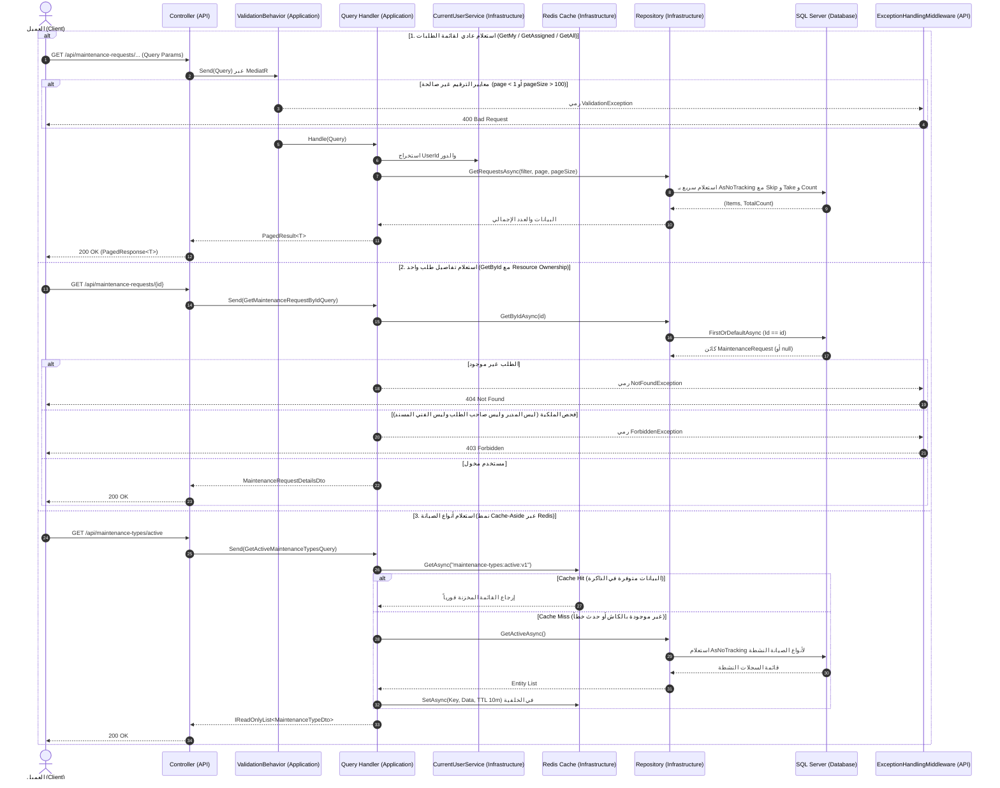
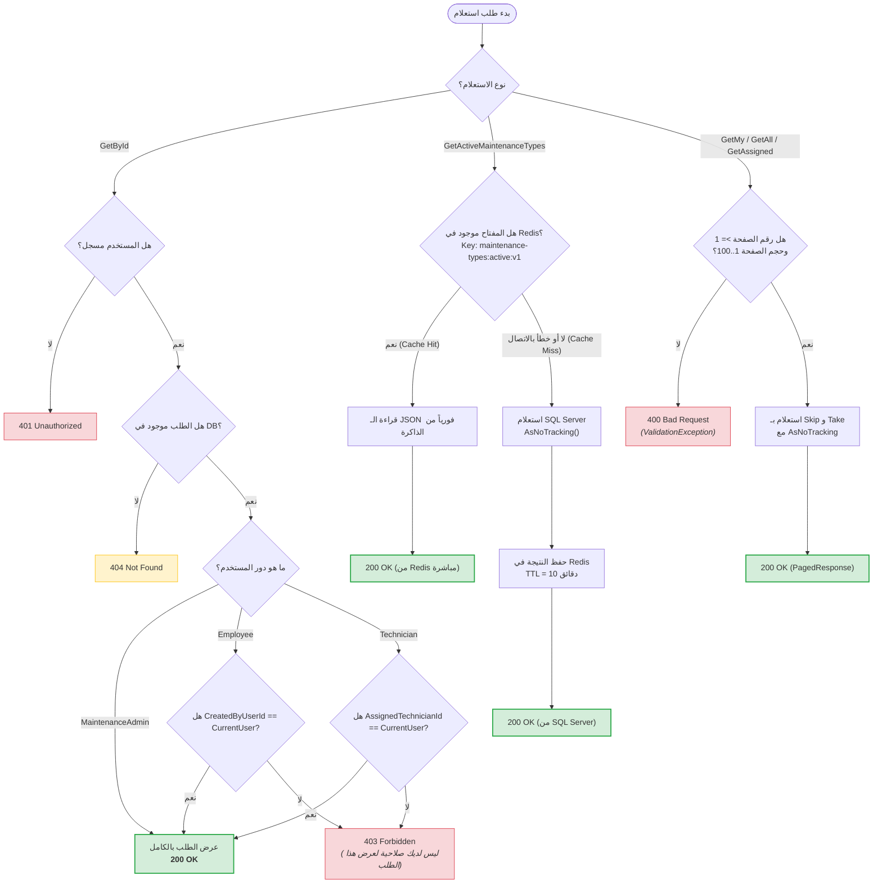

# 🔍 عمليات الاستعلام والتخزين المؤقت (Query Operations & Redis Caching)

> وثيقة تعليمية تفصيلية تشرح عمليات الاستعلام والقراءة (Queries) في نظام إدارة طلبات الصيانة، متضمنةً ترقيم الصفحات (Pagination)، تصفية النتائج (Filtering)، قواعد ملكية الموارد (Resource Ownership)، ونمط التخزين المؤقت المتقدم (Cache-Aside Pattern) باستخدام Redis.

---

## 🌐 1. عقود واجهات الاستعلام (HTTP Query Contracts)

تتبع الاستعلامات مبدأ الفصل بين القراءة والكتابة (CQRS)، حيث تُنفذ عمليات القراءة باستقلالية وكفاءة عالية.

### 📋 ملخص نقاط النهاية (Endpoints Summary)

| نقطة النهاية (Route) | نوع الصلاحية (Authorization) | الوصف والمعاملات المدعومة |
| :--- | :--- | :--- |
| `GET /api/maintenance-requests/my` | مستخدم مصادق عليه (`[Authorize]`) | استعلام طلبات الموظف الخاصة (`page`, `pageSize`, `status`, `priority`). |
| `GET /api/maintenance-requests/{id}` | مستخدم مصادق عليه (`[Authorize]`) | استعلام تفاصيل طلب واحد مع فحص صارم لملكية المورد (Ownership). |
| `GET /api/maintenance-requests/assigned` | `TechnicianOrAdmin` | استعلام الطلبات المسندة للفني الحالي (`page`, `pageSize`, `status`). |
| `GET /api/maintenance-requests` | `MaintenanceAdminOnly` | استعلام شامل لكافة طلبات المؤسسة مع فلاتر كاملة للمدير. |
| `GET /api/maintenance-types/active` | مستخدم مصادق عليه (`[Authorize]`) | استعلام أنواع الصيانة النشطة مع تخزين Redis المؤقت. |

---

### 📦 هيكل الاستجابة المرقمة (PagedResponse Contract)
تعيد استعلامات القوائم كائناً موحداً لترقيم الصفحات [`PagedResponse<T>`](file:///C:/Users/KC-PC/source/repos/MaintenanceSystem/src/MaintenanceSystem.API/Contracts/Common/PagedResponse.cs):
```json
{
  "items": [
    {
      "id": "01925b50-1234-789a-bcde-fedcba987654",
      "title": "عطل في التكييف المركزي",
      "description": "تسريب مياه في مكتب 204",
      "priority": 2,
      "status": 1,
      "maintenanceTypeId": "01925b42-d610-7389-9d7a-123456789abc",
      "createdByUserId": "01925b42-d610-7389-9d7a-111122223333",
      "assignedTechnicianId": null,
      "rejectionReason": null,
      "assignedAtUtc": null,
      "resolvedAtUtc": null,
      "closedAtUtc": null,
      "updatedAtUtc": null,
      "createdAtUtc": "2026-10-17T10:00:00Z"
    }
  ],
  "page": 1,
  "pageSize": 10,
  "totalCount": 42,
  "totalPages": 5,
  "hasPreviousPage": false,
  "hasNextPage": true
}
```

### 🔨 أمثلة استدعاء سريعة (cURL Examples)
```bash
# استعلام طلبات الموظف الخاصة مع فلتر الحالة 1 (New)
curl -X GET "http://localhost:5000/api/maintenance-requests/my?page=1&pageSize=10&status=1" \
     -H "Authorization: Bearer <EMPLOYEE_TOKEN>"

# استعلام تفاصيل طلب محدد بالمعرف
curl -X GET "http://localhost:5000/api/maintenance-requests/01925b50-1234-789a-bcde-fedcba987654" \
     -H "Authorization: Bearer <JWT_TOKEN>"

# استعلام أنواع الصيانة من Redis Cache
curl -X GET "http://localhost:5000/api/maintenance-types/active" \
     -H "Authorization: Bearer <JWT_TOKEN>"
```

---

## 🔄 2. المخطط التتابعي الشامل (Sequence Diagram)

يوضح المخطط التالي تدفق الاستعلامات عبر الطبقات المختلفة مع إبراز مسار الكاش ومسار قاعدة البيانات:



---

## 🔀 3. تفاصيل المسارات الفرعية الأربعة (The 4 Sub-Flows)

---

### 🔹 المسار الفرعي الأول: طلبات الموظف والفني (`GetMy` & `GetAssigned`)

- **الملفات الفعلية:**
  - معالج طلبات الموظف: [`GetMyMaintenanceRequestsQueryHandler.cs`](file:///C:/Users/KC-PC/source/repos/MaintenanceSystem/src/MaintenanceSystem.Application/Features/MaintenanceRequests/GetMyMaintenanceRequests/GetMyMaintenanceRequestsQueryHandler.cs)
  - معالج طلبات الفني: [`GetAssignedMaintenanceRequestsQueryHandler.cs`](file:///C:/Users/KC-PC/source/repos/MaintenanceSystem/src/MaintenanceSystem.Application/Features/MaintenanceRequests/GetAssignedMaintenanceRequests/GetAssignedMaintenanceRequestsQueryHandler.cs)
  - وسيط التحقق: [`GetMyMaintenanceRequestsQueryValidator.cs`](file:///C:/Users/KC-PC/source/repos/MaintenanceSystem/src/MaintenanceSystem.Application/Features/MaintenanceRequests/GetMyMaintenanceRequests/GetMyMaintenanceRequestsQueryValidator.cs)
- **ماذا يحدث في المحطات؟**
  1. **التحقق من الترقيم:** يتأكد الـ Validator أن `Page >= 1` و `PageSize` يقع بين 1 و 100، وأن قيم `status` أو `priority` صحيحة إن وُجدت.
  2. **الهوية الموثوقة:** يقرأ المعالج `_currentUserService.UserId`؛ لا يرسل العميل معرّفه في الـ Query String مطلقاً.
  3. **استعلام المستودع:** يُمرر المعرف إلى [`MaintenanceRequestRepository.cs`](file:///C:/Users/KC-PC/source/repos/MaintenanceSystem/src/MaintenanceSystem.Infrastructure/Persistence/Repositories/MaintenanceRequestRepository.cs).
  4. **كفاءة EF Core:** يتم تطبيق `.AsNoTracking()` لتجنب تتبع الكائنات في الذاكرة، مع حساب الإجمالي بـ `CountAsync` وجلب الصفحة الحالية بـ `Skip` و `Take`.

---

### 🔹 المسار الفرعي الثاني: تفاصيل طلب محدد وفحص الملكية (`GetById`)

- **الملف الفعلي:** [`GetMaintenanceRequestByIdQueryHandler.cs`](file:///C:/Users/KC-PC/source/repos/MaintenanceSystem/src/MaintenanceSystem.Application/Features/MaintenanceRequests/GetMaintenanceRequestById/GetMaintenanceRequestByIdQueryHandler.cs)
- **مصفوفة تخويل قراءة المورد (Resource Ownership Authorization):**

```csharp
var isAuthorized = role switch
{
    RoleNames.MaintenanceAdmin => true,                          // مدير الصيانة يرى كل شيء
    RoleNames.Employee         => entity.CreatedByUserId == userId, // الموظف يرى فقط ما أنشأه
    RoleNames.Technician       => entity.AssignedTechnicianId == userId, // الفني يرى فقط ما أُسند إليه
    _                          => false
};
```

- **خطوات التحقق:**
  1. إذا كان الطلب غير موجود بقاعدة البيانات، يُرمى استثناء [`NotFoundException`](file:///C:/Users/KC-PC/source/repos/MaintenanceSystem/src/MaintenanceSystem.Application/Common/Exceptions/NotFoundException.cs) (404).
  2. إذا كان الطلب موجوداً ولكن المستخدم الحالي ليس إدارياً، ولا صاحب الطلب، ولا الفني المسند له، يُرمى استثناء [`ForbiddenException`](file:///C:/Users/KC-PC/source/repos/MaintenanceSystem/src/MaintenanceSystem.Application/Common/Exceptions/ForbiddenException.cs) برمز **`403 Forbidden`**.

> [!IMPORTANT]
> **مبدأ خصوصية البيانات (Data Privacy):**
> لا يمكن لموظف الاطلاع على تفاصيل طلب قدمه زميل آخر بمجرد تخمين الـ GUID، ولا يمكن لفني استعراض تفاصيل طلبات لم تُسند إليه.

---

### 🔹 المسار الفرعي الثالث: استعلام الإدارة والفلترة المتقدمة (`GetAll`)

- **الملف الفعلي:** [`GetAllMaintenanceRequestsQueryHandler.cs`](file:///C:/Users/KC-PC/source/repos/MaintenanceSystem/src/MaintenanceSystem.Application/Features/MaintenanceRequests/GetAllMaintenanceRequests/GetAllMaintenanceRequestsQueryHandler.cs)
- **الأمان:** محمي بسياسة `[Authorize(Policy = Policies.MaintenanceAdminOnly)]`.
- **الفلاتر المدعومة بالتزامن:**
  - `status`: تصفية حسب حالة الطلب (`New`, `Assigned`, `InProgress`, `Resolved`, `Closed`, `Rejected`).
  - `priority`: تصفية حسب درجة الأهمية (`Low`, `Medium`, `High`, `Critical`).
  - `technicianId`: استعراض كافة الطلبات المسندة لفني بعينه.
  - `maintenanceTypeId`: استعراض كافة الطلبات التابعة لقسم أو تصنيف محدد (سباكة، كهرباء...).
- **الترتيب:** تُعرض النتائج دائماً بترتيب زمني تنازلي من الأحدث إلى الأقدم (`OrderByDescending(r => r.CreatedAtUtc)`).

---

### 🔹 المسار الفرعي الرابع: استعلام أنواع الصيانة والتخزين المؤقت في Redis

- **الملفات الفعلية:**
  - المعالج: [`GetActiveMaintenanceTypesQueryHandler.cs`](file:///C:/Users/KC-PC/source/repos/MaintenanceSystem/src/MaintenanceSystem.Application/Features/MaintenanceTypes/GetActiveMaintenanceTypes/GetActiveMaintenanceTypesQueryHandler.cs)
  - كاش ريديس: [`RedisMaintenanceTypeCache.cs`](file:///C:/Users/KC-PC/source/repos/MaintenanceSystem/src/MaintenanceSystem.Infrastructure/Caching/RedisMaintenanceTypeCache.cs)
  - واجهة الكاش: [`IMaintenanceTypeCache.cs`](file:///C:/Users/KC-PC/source/repos/MaintenanceSystem/src/MaintenanceSystem.Application/Abstractions/Caching/IMaintenanceTypeCache.cs)
- **مواصفات التخزين المؤقت:**
  - **مفتاح الكاش (Cache Key):** `"maintenance-types:active:v1"`
  - **مدة الصلاحية (TTL):** 10 دقائق (`TimeSpan.FromMinutes(10)`).
  - **الترميز:** `System.Text.Json` مع خيارات `JsonSerializerDefaults.Web`.
- **استراتيجية الصمود ضد الأعطال (Cache-Aside & Fault-Tolerance):**
  - عند حدوث أي استثناء أو انقطاع في الاتصال بخادم Redis (`RedisConnectionException` أو غيرها)، تلتقط دالة `GetAsync` الاستثناء، وتسجل تحذيراً `_logger.LogWarning`، وتعيد `null`.
  - يواصل المعالج عمله بسلاسة بالرجوع التلقائي إلى SQL Server (`Fallback to Database`)، مما يضمن استمرارية عمل التطبيق 100% حتى لو كان Redis معطلاً بالكامل.

---

## 🌳 4. شجرة القرار لملكية المورد والكاش (Decision Tree)



---

## ⚠️ 5. مصفوفة الاستثناءات وحالات الخطأ (Exceptions Matrix)

| رمز الحالة (Status) | الاستثناء البرمجي (Exception) | السبب المباشر (Trigger) | شكل الاستجابة (ProblemDetails Format) |
| :--- | :--- | :--- | :--- |
| **`400 Bad Request`** | `ValidationException` | - رقم الصفحة أقل من 1 (`Page < 1`).<br>- حجم الصفحة خارج النطاق المسموح (`PageSize > 100` أو `< 1`).<br>- قيمة تصفية خاطئة لحالة أو أولوية الطلب. | `{"status": 400, "title": "Validation Error", "validationErrors": {"PageSize": ["حجم الصفحة يجب أن يكون بين 1 و 100."]}}` |
| **`401 Unauthorized`** | `UnauthorizedException` | إرسال طلب بدون توكن Bearer أو تعذر قراءة معرف المستخدم من الـ Claims. | `{"status": 401, "title": "Unauthorized", "detail": "المستخدم غير مصادق عليه."}` |
| **`403 Forbidden`** | `ForbiddenException` / Auth Policy | - موظف يحاول الاطلاع على طلب موظف آخر في `GetById`.<br>- فني يحاول استعراض طلب غير مسند إليه.<br>- غير المدراء يحاولون استدعاء `GET /api/maintenance-requests`. | `{"status": 403, "title": "Forbidden", "detail": "ليس لديك صلاحية لعرض هذا الطلب."}` |
| **`404 Not Found`** | `NotFoundException` | طلب الصيانة المطلوب استعراضه بالـ `id` غير موجود في قاعدة البيانات. | `{"status": 404, "title": "Not Found", "detail": "طلب الصيانة بالمعرّف '...' غير موجود."}` |
| **`500 Internal Error`** | `Exception` | - خطأ داخلي غير متوقع في معالجة استجابة Redis.<br>- انقطاع مفاجئ في الاتصال بقاعدة بيانات SQL Server. | `{"status": 500, "title": "Internal Server Error", "detail": "An unhandled error occurred."}` |

---

## ⚡ 6. طبقات الأداء وحماية البيانات (Performance & Security)

1. **إلغاء التتبع لعمليات القراءة (`AsNoTracking`):**
   - كافة استعلامات القراءة تستخدم `.AsNoTracking()`. هذا يعطل الـ Change Tracker في EF Core تماماً، مما يوفر استهلاك الذاكرة ويضاعف سرعة الاستعلامات بمقدار 2x إلى 3x.
2. **عزل النطاق والأمان في الترقيم (Bounded Pagination):**
   - تحديد الحد الأقصى لحجم الصفحة بـ 100 عنصر يمنع هجمات حجب الخدمة (DDoS/Memory Exhaustion) الناتجة عن محاولة جلب ملايين السجلات في طلب واحد.
3. **الصمود العالي للتخزين المؤقت (Graceful Degradation):**
   - تصميم `RedisMaintenanceTypeCache` يبتلع استثناءات الشبكة ويتحول لقاعدة البيانات بسلاسة دون أن يلاحظ العميل أي عطل.
4. **حماية ملكية الموارد (Fine-Grained Resource Ownership):**
   - التحقق متعدد المستويات يضمن خصوصية البيانات بالكامل حتى داخل المؤسسة الواحدة.

---

## 🧪 7. كيفية اختبار الاستعلامات (Testing Guide)

### أ) اختبارات الوحدة (Unit Tests)
- [`GetMaintenanceRequestByIdQueryHandlerTests.cs`](file:///C:/Users/KC-PC/source/repos/MaintenanceSystem/tests/MaintenanceSystem.Tests/Application/Handlers/GetMaintenanceRequestByIdQueryHandlerTests.cs):
  - اختبار نجاح القراءة للمدير، ولصاحب الطلب، وللفني المسند.
  - اختبار رمي `ForbiddenException` لمستخدم غريب وتوقع 403.
  - اختبار رمي `NotFoundException` عند عدم وجود السجل وتوقع 404.
- [`GetMyMaintenanceRequestsQueryValidatorTests.cs`](file:///C:/Users/KC-PC/source/repos/MaintenanceSystem/tests/MaintenanceSystem.Tests/Application/Validators/GetMyMaintenanceRequestsQueryValidatorTests.cs):
  - اختبار رفض `Page = 0` و `PageSize = 101`.
- [`GetActiveMaintenanceTypesQueryHandlerTests.cs`](file:///C:/Users/KC-PC/source/repos/MaintenanceSystem/tests/MaintenanceSystem.Tests/Application/Handlers/GetActiveMaintenanceTypesQueryHandlerTests.cs):
  - اختبار جلب البيانات من الكاش عند الـ Hit دون استدعاء المستودع.
  - اختبار جلب البيانات من المستودع عند الـ Miss وتخزينها في الكاش.

### ب) اختبارات التكامل (Integration Tests)
- [`MaintenanceRequestEndpointsTests.cs`](file:///C:/Users/KC-PC/source/repos/MaintenanceSystem/tests/MaintenanceSystem.Tests/Integration/MaintenanceRequestEndpointsTests.cs):
  - اختبار فحص الملكية واستجابات الترقيم المتعددة.
- [`MaintenanceTypeEndpointsTests.cs`](file:///C:/Users/KC-PC/source/repos/MaintenanceSystem/tests/MaintenanceSystem.Tests/Integration/MaintenanceTypeEndpointsTests.cs):
  - اختبار سرعة استجابة نقطة النهاية النشطة ومطابقة النتائج مع الذاكرة.

### ج) الفحص السريع عبر PowerShell
```powershell
# 1. اختبار استعلام مع خطأ ترقيم (توقع 400 Bad Request)
try {
    Invoke-RestMethod -Uri "http://localhost:5000/api/maintenance-requests/my?page=0&pageSize=200" -Headers @{ Authorization = "Bearer $token" }
} catch {
    $_.Exception.Response.StatusCode # يطبع 400
}

# 2. اختبار استعلام الكاش في Redis
$types = Invoke-RestMethod -Uri "http://localhost:5000/api/maintenance-types/active" -Headers @{ Authorization = "Bearer $token" }
$types | Format-Table Id, Name, IsActive
```

---

## 💡 8. نقاط ذهبية للتذكر (Golden Architecture Takeaways)

> [!TIP]
> - **تذكر:** في نمط CQRS، كائنات الـ DTO الخاصة بالاستعلامات يجب أن تكون مسطحة وخفيفة ومعدة خصيصاً لاحتياج الواجهة؛ لا تعيد كينونات الدومين (`Entities`) في استجابات الـ API مطلقاً.
> - **تذكر:** دائماً استخدم `.AsNoTracking()` في استعلامات القراءة؛ عدم استخدامها يهدر موارد الخادم في تتبع كائنات لن يتم تعديلها أبداً.
> - **تذكر:** التخزين المؤقت عبر Redis هو وسيلة تسريع وليس مخزن الحقيقة الوحيد؛ احرص دائماً على وجود آلية ارتداد (Fallback) آمنة لقاعدة البيانات في حال تعطل الكاش.
> - **مشكلة حقيقية شائعة:** الثقة في `page` و `pageSize` القادمة من العميل دون وضع سقف أعلى (`InclusiveBetween(1, 100)`)؛ ترك هذا الأمر مفتوحاً يسمح للمخترقين بطلب `pageSize=1000000` لإسقاط الخادم بنفاد الذاكرة.
